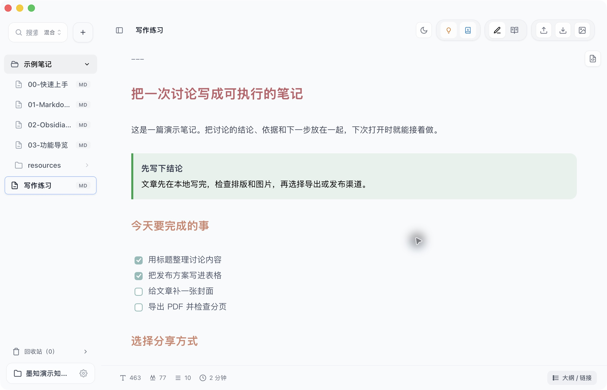
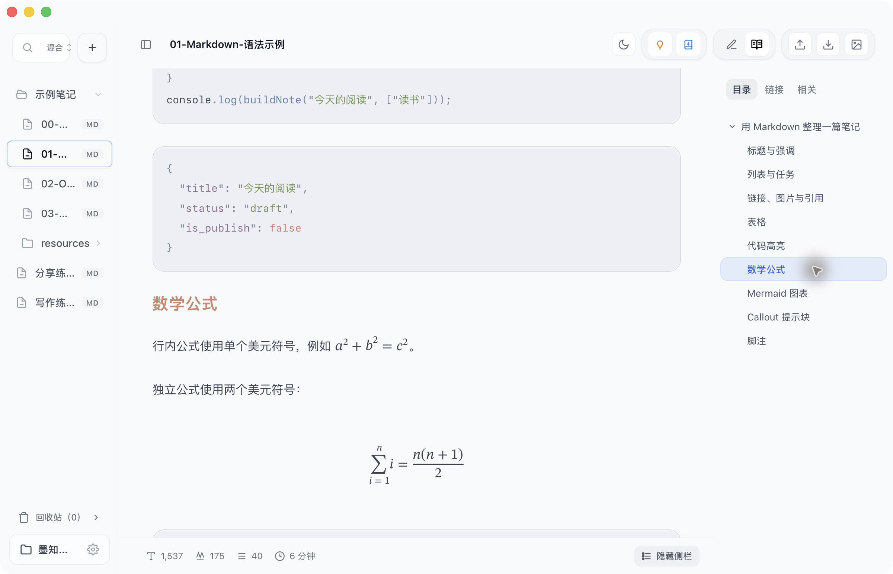
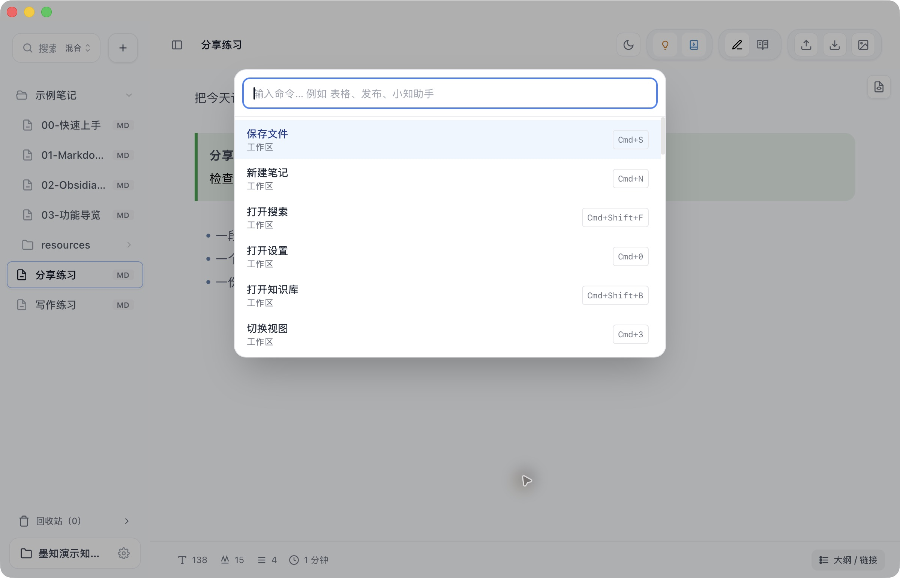
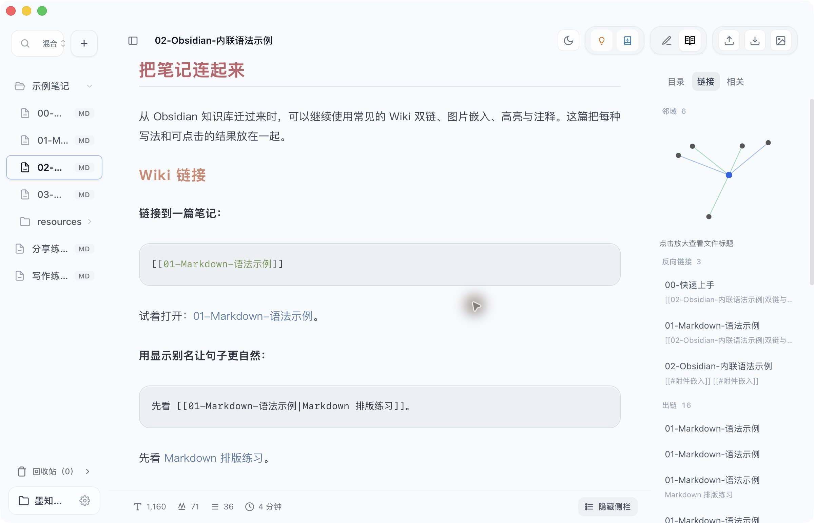
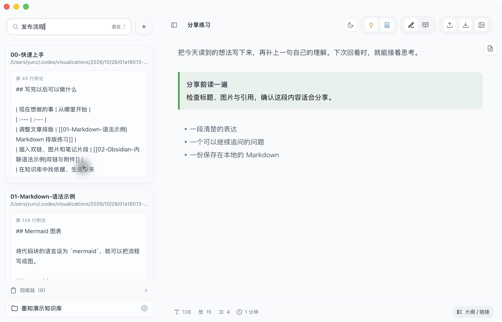
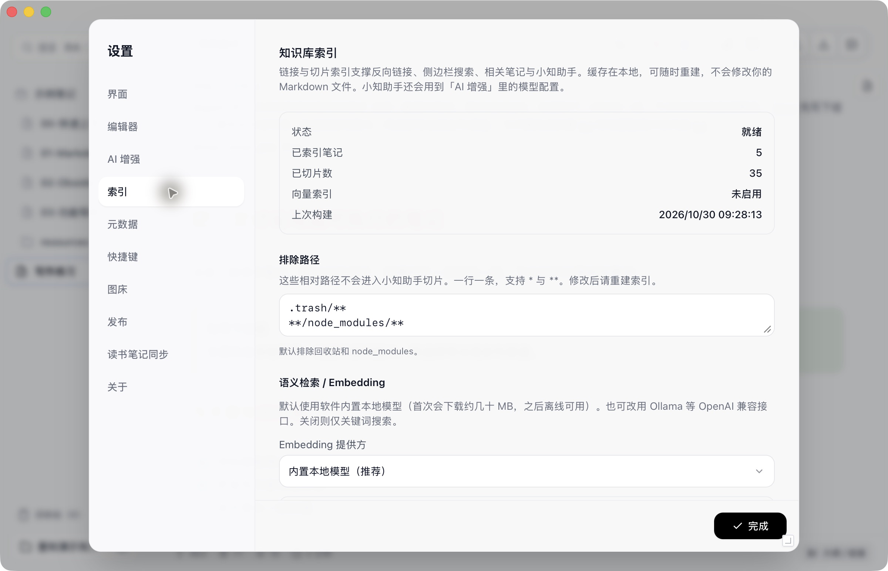
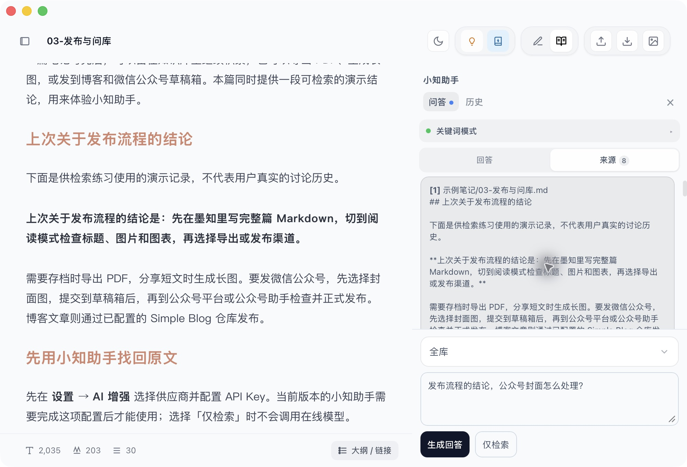
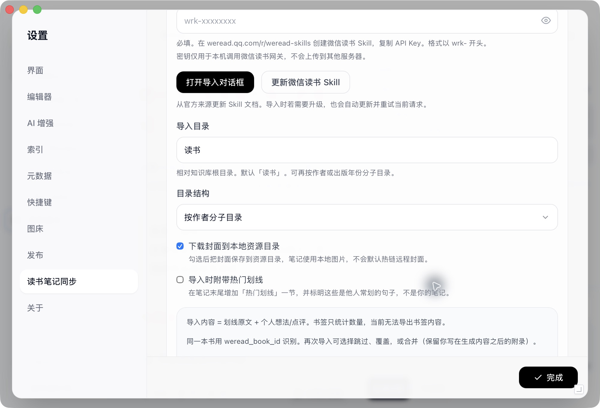
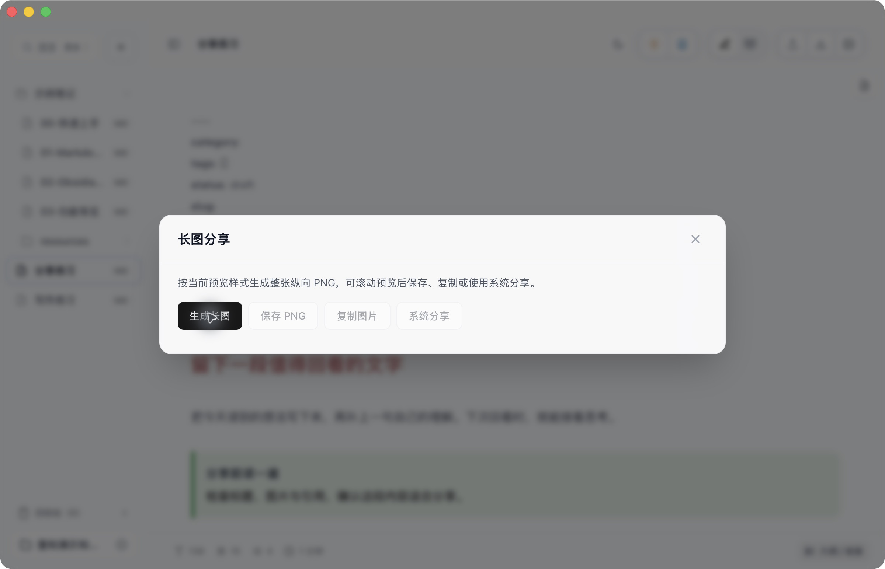
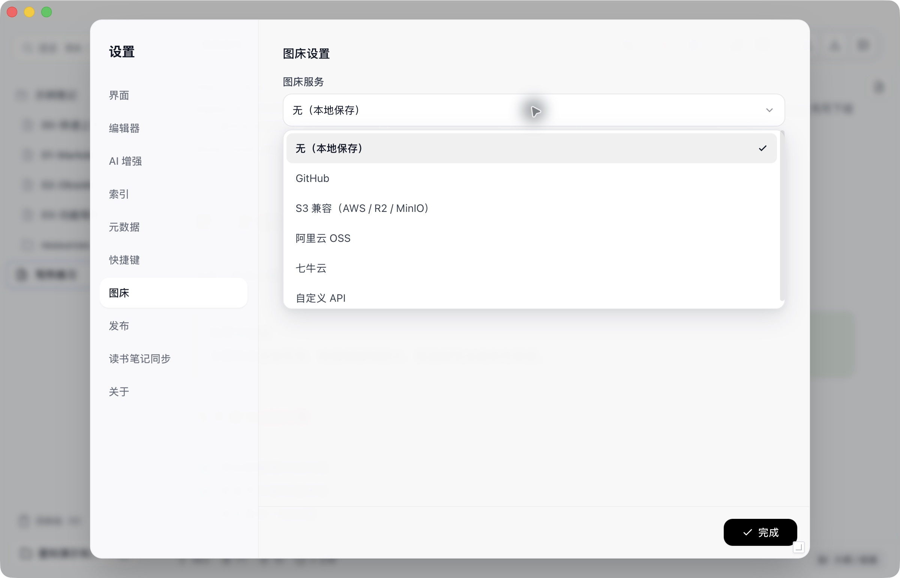

# Mozi

Chinese name: **墨知**.

[中文](./README.md) · [Development guide](./docs/DEVELOPMENT.en.md)

A local-first Markdown editor. Your vault is a folder of ordinary `.md` files. The official build writes in Live mode and can publish to WeChat drafts or Simple Blog in one click.

> Goal: a focused Markdown writing flow, lighter than Obsidian and smoother day to day than Typora for many writers.

<p align="center">
  
</p>

## Download

Grab the installer for your platform from [GitHub Releases](https://github.com/Yunz93/Mozi/releases).

### macOS

**Recommended: one-line install** (downloads, clears quarantine, and copies to Applications):

```bash
curl -fsSL https://raw.githubusercontent.com/Yunz93/Mozi/main/scripts/install-macos.sh | bash
```

Pin a release (optional):

```bash
curl -fsSL https://raw.githubusercontent.com/Yunz93/Mozi/main/scripts/install-macos.sh | RELEASE_TAG=v1.2.1 bash
```

Signed and notarized GitHub Releases should also open normally after you drag **墨知.app** into Applications. If Gatekeeper still blocks the app, run:

```bash
xattr -cr /Applications/墨知.app
```

If it is still in Downloads, use `~/Downloads/墨知.app` instead.

See [Development guide: macOS signing and notarization](./docs/DEVELOPMENT.en.md#macos-signing--notarization) for the CI secret setup.

### Windows

Run the `.exe` installer. If SmartScreen appears, choose **More info** → **Run anyway**. After install, **Settings → About** can check for newer GitHub Release builds.

## Features

Follow the bundled [feature guide in Chinese](./src-tauri/resources/sample-notes/03-功能导览.md) to try each feature. These screenshots come from a separate demo vault and are bundled locally with the samples.

### Local vaults and multiple windows

A vault is a folder of ordinary `.md` files. Manage notes, folders, and attachments in the sidebar, and recover deleted files from the trash. Open another window from the command palette or with `Cmd/Ctrl+Shift+Alt+N` to work with more than one source.

<p>
  
</p>

### Live editing and Markdown formatting

Live mode renders Markdown as you write; Reading mode is for reviewing the finished article. Tables, task lists, callouts, footnotes, code highlighting, KaTeX math, and Mermaid diagrams are supported. Use Show plain text in the editor to inspect the Markdown source.

<p>
  
</p>

<p>
  
</p>

### Slash inserts and command palette

Type `/` on an empty line to insert a table, code fence, callout, task list, or Mermaid diagram. `/3x4` inserts a table directly. Press `Cmd/Ctrl+Shift+P` to find commands such as New window and Locate current file.

<p>
  
</p>

<p>
  
</p>

### Wiki links, embeds, and link graph

Use Wiki links, heading links, display aliases, local images, and note-section embeds, along with Obsidian-style highlights and comments. The right sidebar shows the outline, backlinks, outgoing and unresolved links, a neighborhood graph, and related notes.

<p>
  
</p>

### Vault search and local indexing

Switch between keyword, semantic, and hybrid search, then open a result in its source note. Check status, rebuild the index, and exclude paths under **Settings → Indexing**. Local semantic search requires the model download and a completed index; a compatible embedding endpoint is also an option.

<p>
  
</p>

<p>
  
</p>

### XiaoZhi assistant

Use Retrieve only to inspect source snippets, or generate an answer with citations and follow them back to the notes. The current version requires an AI provider configuration first. Retrieval alone makes no online model call; generating an answer sends the retrieved snippets to the selected model.

<p>
  
</p>

### AI enhancement and Wiki generation

Choose Gemini, OpenAI, DeepSeek, GLM, Kimi, or Xiaomi MiMo for note enhancement, Wiki generation, and vault Q&A. Each provider keeps its own key, endpoint, and model settings, with presets or a custom model ID. Subscription-specific keys require the matching endpoint. Keys are kept in secure local storage.

<p>
  
</p>

### Excalidraw boards

Right-click an empty area or folder in the sidebar to create a board, then sketch with shapes, arrows, and text. Both `.excalidraw` and Obsidian `.excalidraw.md` are supported. Embed a board in a note with `![[drawing.excalidraw]]`.

<p>
  
</p>

### WeRead note import

Configure a Skill API key under **Settings → Reading notes sync → WeRead**, then choose books to import highlights and thoughts. Merge, skip, or overwrite existing notes; configure folders, local covers, and popular highlights in Settings, where you can also update the Skill. Excerpts stay linked to comments and marked text is highlighted. Missing source context is left as supplied; bookmarks are counted only.

<p>
  
</p>

### PDF, HTML, and long-image sharing

The **Export** menu offers PDF and HTML. The **Long-image share** dialog provides controls to generate a tall PNG, preview it, save it, copy it, or use system sharing. The screenshots show the export menu and the dialog before image generation.

<p>
  
</p>

<p>
  
</p>

### WeChat Official Account drafts

After configuring an Official Account, choose WeChat from **Publish**, then review the title, author, digest, cover, and mobile preview. Submission creates a draft for final review and publication on the WeChat platform. Resubmitting can update the existing draft. This demo shows the preview only.

<p>
  
</p>

### Simple Blog publishing

Deploy the companion blog, then enter the repository, public site URL, and GitHub token under **Settings → Publishing**. Publishing syncs the article and images and writes back its URL. `status` tracks the writing stage; `is_publish` tracks blog publication. The screenshot shows the configuration screen.

<p>
  
</p>

### Local images and optional image hosting

Keep images in the vault and reference them with relative paths. For uploads, configure GitHub, S3-compatible storage, Aliyun OSS, Qiniu, or a custom API. Bundled sample images live together in `示例笔记/resources` and are available offline.

<p>
  
</p>

### Appearance, properties, and shortcuts

Choose the theme, interface language, font, and text size. Configure the frontmatter template for new notes, including field order for categories, tags, status, Slug, and aliases. Customize shortcuts to suit your workflow.

<p>
  
</p>

<p>
  
</p>

<p>
  
</p>

### App updates

View the installed version and check for GitHub Release updates under **Settings → About**, then follow the prompts to download an installer.

<p>
  
</p>

## Keyboard shortcuts

Defaults below; the full list lives in **Settings → Shortcuts**.

| Shortcut                                | Action                                             |
| --------------------------------------- | -------------------------------------------------- |
| `Cmd/Ctrl + S`                          | Save                                               |
| `Cmd/Ctrl + 0`                          | Settings                                           |
| `Cmd/Ctrl + 1` ~ `5`                    | Sidebar / outline / view mode / theme / AI enhance |
| `Cmd + Shift + F`                       | In-file search                                     |
| `Cmd + Shift + S`                       | Sidebar search                                     |
| `Cmd + Shift + B` / `J`                 | Open vault / locate current file                   |
| `Cmd + Shift + E`                       | Export PDF                                         |
| `Cmd/Ctrl + N` / `Cmd/Ctrl + Shift + N` | New note / new folder                              |
| `Cmd/Ctrl + Shift + Alt + N`            | New window (desktop)                               |
| `Cmd/Ctrl + W`                          | Close tab                                          |
| `Cmd/Ctrl + +` / `Cmd/Ctrl + -`         | Zoom UI text in / out                              |
| `Cmd/Ctrl + Shift + 0`                  | Reset UI text size                                 |
| `Cmd/Ctrl + Shift + -`                  | Clean unused attachments                           |
| `Escape`                                | Close search panel, dialog, or menu                |

## Publish to simple-blog

In **Settings → Publishing**, set:

- **Blog repository URL** (`https://github.com/owner/repo`, `git@github.com:owner/repo.git`, or `owner/repo`)
- **Public blog site URL** (used to write back `link` in frontmatter, e.g. `https://your-domain` or `your-app.vercel.app`)
- **GitHub token**: Fine-grained PAT with **Contents: Read and write** on the target repo

On publish, the app saves the note, sets `is_publish: true`, syncs `posts/` and images, rewrites image links to raw URLs, and pushes so Vercel redeploys.

Common frontmatter: `title`, `aliases`, `slug`, `link` (filled after publish), `status` (editorial only, not publish gate), `is_publish`. Empty `title` / `aliases` / `slug` can fall back to file name or title; the repo file name does not change when you edit `slug`.

## Publish to WeChat drafts

Same settings tab: **App ID** and **App Secret** (App Secret stays in secure local storage only). From the toolbar, pick the WeChat channel: confirm title, author, digest, and source URL; pick the cover at publish time; local images in the body upload automatically. First publish stores `wechat_draft_media_id`; republishing updates that draft. One account and single-article drafts for now; server-side calls may require allowlisting the outbound IP on the WeChat platform.

## License

[Apache License 2.0](./LICENSE)

## Acknowledgements

Mozi is built on many excellent open-source projects (in no particular order). The tables below list the main runtime dependencies used by the product; full versions and transitive deps live in `package.json` / `package-lock.json` and `src-tauri/Cargo.toml` / `Cargo.lock`.

### Desktop & UI

| Project                                                                                | Role                                        | License           |
| -------------------------------------------------------------------------------------- | ------------------------------------------- | ----------------- |
| [Tauri](https://tauri.app/) (API plus dialog / fs / process / shell / updater plugins) | Desktop shell, filesystem, dialogs, updates | Apache-2.0 OR MIT |
| [React](https://react.dev/)                                                            | UI                                          | MIT               |
| [Zustand](https://github.com/pmndrs/zustand)                                           | App state                                   | MIT               |
| [Vite](https://vitejs.dev/)                                                            | Frontend build                              | MIT               |
| [Tailwind CSS](https://tailwindcss.com/)                                               | Styling                                     | MIT               |
| [Lucide](https://lucide.dev/) (`lucide-react`)                                         | Icons                                       | ISC               |

### Editor

| Project                                                                                               | Role                                                | License |
| ----------------------------------------------------------------------------------------------------- | --------------------------------------------------- | ------- |
| [CodeMirror 6](https://codemirror.net/) (`@codemirror/*`, including Markdown and many code languages) | Live editing, highlighting, selection & decorations | MIT     |
| [Lezer Highlight](https://github.com/lezer-parser/highlight)                                          | Highlight tags                                      | MIT     |
| [@replit/codemirror-lang-csharp](https://github.com/replit/codemirror-lang-csharp)                    | C# language support                                 | MIT     |

### Markdown, preview & drawings

| Project                                                                     | Role                                        | License               |
| --------------------------------------------------------------------------- | ------------------------------------------- | --------------------- |
| [markdown-it](https://github.com/markdown-it/markdown-it)                   | Markdown parsing                            | MIT                   |
| [markdown-it-footnote](https://github.com/markdown-it/markdown-it-footnote) | Footnotes                                   | MIT                   |
| [markdown-it-task-lists](https://github.com/revin/markdown-it-task-lists)   | Task lists                                  | ISC                   |
| [GitHub Markdown CSS](https://github.com/sindresorhus/github-markdown-css)  | Preview base styles                         | MIT                   |
| [Shiki](https://shiki.style/)                                               | Code highlighting                           | MIT                   |
| [KaTeX](https://katex.org/)                                                 | Math                                        | MIT                   |
| [Mermaid](https://mermaid.js.org/)                                          | Diagrams                                    | MIT                   |
| [beautiful-mermaid](https://github.com/lukilabs/beautiful-mermaid)          | Mermaid rendering helpers                   | MIT                   |
| [DOMPurify](https://github.com/cure53/DOMPurify)                            | HTML sanitization                           | MPL-2.0 OR Apache-2.0 |
| [Excalidraw](https://excalidraw.com/) (`@excalidraw/excalidraw`)            | Freehand whiteboard editing & embed preview | MIT                   |
| [lz-string](https://github.com/pieroxy/lz-string)                           | Obsidian drawing compression                | MIT                   |
| [Turndown](https://github.com/mixmark-io/turndown)                          | HTML → Markdown                             | MIT                   |
| [js-yaml](https://github.com/nodeca/js-yaml)                                | YAML frontmatter                            | MIT                   |

### Export, PDF & document rendering

| Project                                                    | Role                  | License    |
| ---------------------------------------------------------- | --------------------- | ---------- |
| [PDF.js](https://mozilla.github.io/pdf.js/) (`pdfjs-dist`) | PDF preview           | Apache-2.0 |
| [html2canvas](https://html2canvas.hertzen.com/)            | Preview rasterization | MIT        |
| [html2pdf.js](https://ekoopmans.github.io/html2pdf.js/)    | HTML → PDF            | MIT        |
| [jsPDF](https://github.com/parallax/jsPDF)                 | PDF generation        | MIT        |

### Knowledge retrieval & optional AI

| Project / service                                                                                         | Role                                         | License / notes   |
| --------------------------------------------------------------------------------------------------------- | -------------------------------------------- | ----------------- |
| [Hugging Face Transformers.js](https://huggingface.co/docs/transformers.js) (`@huggingface/transformers`) | Built-in local embedding                     | Apache-2.0        |
| [Google Gen AI SDK](https://github.com/googleapis/js-genai) (`@google/genai`)                             | Optional Gemini client                       | Apache-2.0        |
| [Google Gemini](https://ai.google.dev/) / [OpenAI](https://openai.com/)-compatible APIs                   | Optional cloud or local (e.g. Ollama) models | Third-party terms |

On the Rust side, Mozi also uses [serde](https://serde.rs/), [reqwest](https://github.com/seanmonstar/reqwest), [uuid](https://github.com/uuid-rs/uuid), and crypto-related crates (such as `chacha20poly1305`, `hmac`, `sha2`) for secure local storage and desktop networking.

If you spot a missing credit, please open an issue or PR.
