# 墨知

英文名：**Mozi**。

[English](./README.en.md) · [开发文档](docs/development/README.md)

本地优先的 Markdown 编辑器。把文件夹当知识库，笔记就是普通 `.md` 文件。2.2.0 新增待办日历、到期提醒和可选的 macOS 系统日历同步，支持专注模式与 Live 链接预览。

> 目标：比 Typora 更顺手、比 Obsidian 更轻量的纯 Markdown 写作体验。

<p align="center">
  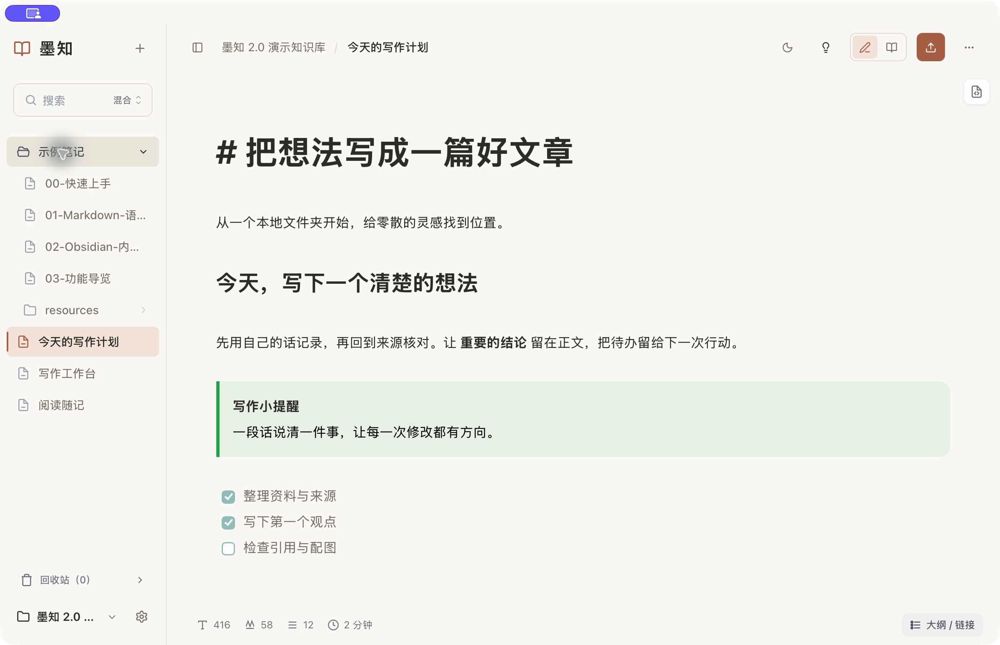
</p>

## 下载安装

在 [GitHub Releases](https://github.com/Yunz93/Mozi/releases) 获取当前平台的安装包。

### macOS

**推荐：一键安装**（自动下载、移除隔离标记并安装到「应用程序」）

```bash
curl -fsSL https://raw.githubusercontent.com/Yunz93/Mozi/main/scripts/install-macos.sh | bash
```

指定版本（可选）：

```bash
curl -fsSL https://raw.githubusercontent.com/Yunz93/Mozi/main/scripts/install-macos.sh | RELEASE_TAG=v2.2.0 bash
```

已配置 Apple 开发者证书与公证凭据的 Release 通常也可直接拖入「应用程序」打开。若系统仍提示无法验证开发者，将 `墨知.app` 放入「应用程序」后执行：

```bash
xattr -cr /Applications/墨知.app
```

若仍在「下载」中，把路径换成 `~/Downloads/墨知.app`。

证书与公证配置见 [开发文档 - macOS 签名公证](docs/development/README.md#macos-签名与公证)。

### Windows

运行 `.exe` 安装。SmartScreen 提示时选「更多信息」→「仍要运行」。安装后可在 **设置 → 关于** 检查 GitHub Release 更新。

### Linux

提供 Linux x64 的 `.deb` 安装包，适用于 Ubuntu 24.04 及兼容环境；支持桌面启动器和 Markdown 文件关联。

```bash
sudo apt install ./Mozi_2.3.0_amd64.deb
```

Linux 暂不支持应用内自动更新，升级时请从 GitHub Releases 下载并安装新版 `.deb`。

## 特色功能

跟着内置 [功能导览](./src-tauri/resources/sample-notes/03-功能导览.md) 逐项体验。以下截图来自独立演示知识库，均随示例保存在本地。

### 2.0.0 工作区与启动页

默认使用 macOS 或 Windows 的系统无衬线字体。浅色采用暖白表面，深色采用金属灰，侧栏、正文、上下栏和设置保持一致。顶部按主题、专注与待办、编辑与阅读、小知助手与 AI 增强、发布与更多排列，使用分组框，悬停可查看名称；知识库名称入口仍在左下，设置在右侧。

<p>
  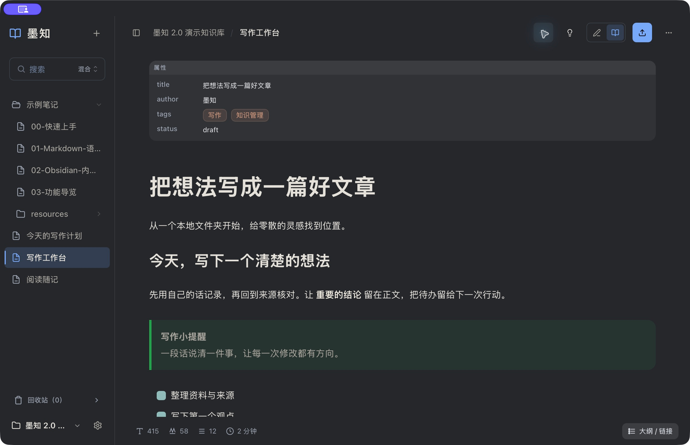
</p>

打开知识库和恢复工作区时也使用相同的主题与字体。

<p>
  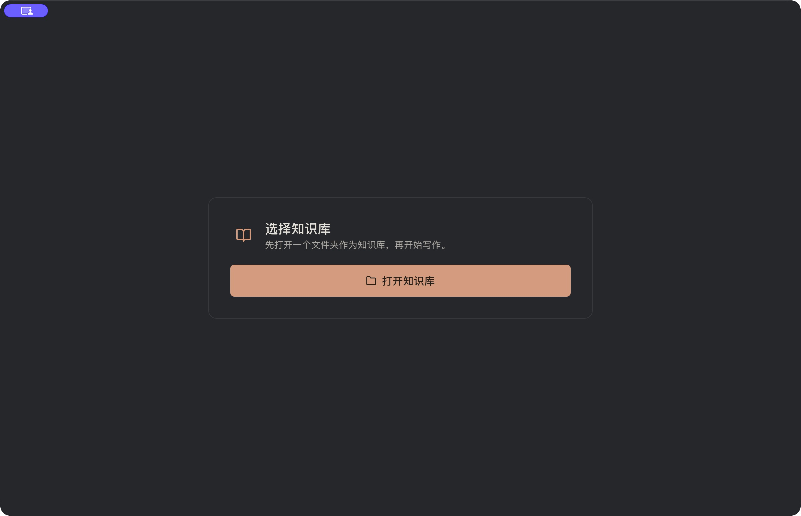
</p>

### 本地知识库与多窗口

文件夹就是知识库，笔记以普通 `.md` 文件保存。左侧管理目录、笔记和附件，回收站用于找回误删文件。通过命令面板或 `Cmd/Ctrl+Shift+Alt+N` 新建窗口，分别查看不同材料。

<p>
  
</p>

### 实时预览与 Markdown 排版

Live 实时预览边写边渲染，阅读模式用于检查成稿。支持表格、任务列表、Callout、脚注、代码高亮、KaTeX 公式与 Mermaid 图表。编辑区的「显示纯文本」可以查看 Markdown 源码。

表格内输入即时写入正文，支持格式快捷键、多单元格复制粘贴、行列移动和对齐。代码块可切换语言和复制内容，右键图片可修改来源、说明与尺寸。链接平时只显示文字，光标进入后展开完整 Markdown；文字为空时显示网址。

顶部工具栏按功能使用分组框，主题按钮后是专注模式和待办事项。专注模式让编辑器全屏并隐藏其他界面，按 Esc 或 F8 退出，也可在 **设置 → 编辑** 调整。待办按钮打开竖向浮层，正文保持可见。

<p>
  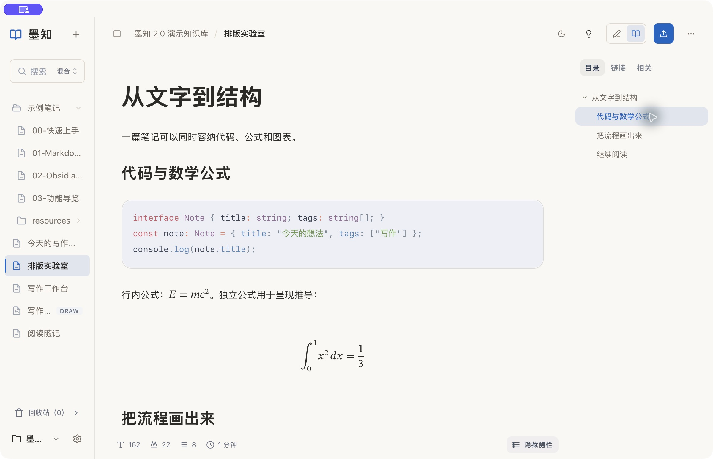
</p>

<p>
  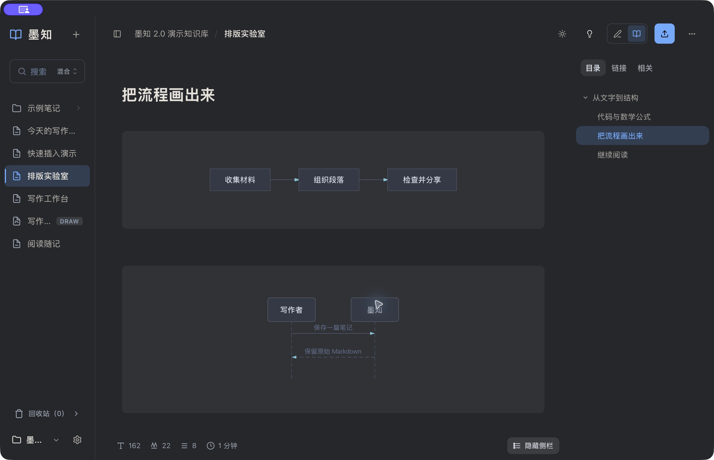
</p>

### 待办与日程

顶部工具栏的 **待办事项** 按钮打开竖向浮层，汇总知识库中的文件待办，支持月历、清单、搜索和逾期筛选。点击任务可定位回笔记原文；界面跟随软件的主题、强调色和字号设置。

在 Markdown 待办后填写完整日期，保存后自动同步：

```markdown
- [ ] 提交方案 @2026-11-10 15:00
- [ ] 整理资料 @2026-11-12
- [ ] 未安排日期的任务
```

带时间的任务到点提醒；只有日期的任务按全天显示，默认当天 09:00 提醒。勾选完成、修改日期或移除日期后，保存会更新提醒。代码块、行内代码和转义的日期标记不生成日程。

在 **设置 → 待办与日程** 开启系统通知，可发送测试提醒，并选择关窗后留在后台继续提醒。完全退出后停止提醒，休眠或退出期间错过的提醒在恢复后汇总。横幅和声音受系统通知设置与专注模式控制；Windows 需要在安装版中验证通知。

macOS 可在同处开启 **同步到 macOS 系统日历**，授权完整日历访问并选择可写的目标日历。已保存、有有效日期的未完成待办会单向同步为事件；改期后更新，完成、删除或移出纳入范围后移除墨知创建的对应事件。全天任务为全天事件，定时任务显示为 30 分钟事件，来源笔记链接保存在事件中。日历中的修改不会回写笔记，关闭同步后保留已有事件。日历事件不另设提醒，避免和墨知通知重复。

### 斜杠菜单与命令面板

空行输入 `/`，插入表格、代码、提示块、待办或 Mermaid 图表；`/3x4` 可以快速插入表格。按 `Cmd/Ctrl+Shift+P` 搜索命令，找到新建窗口、定位文件等操作。

<p>
  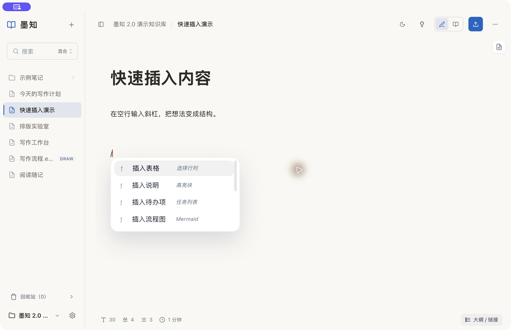
</p>

<p>
  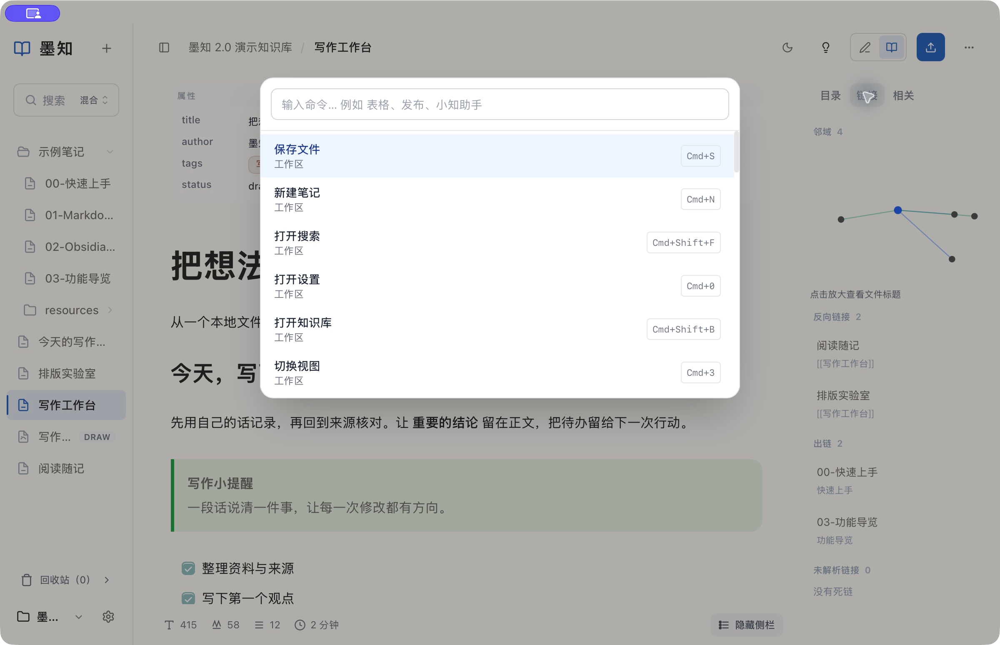
</p>

### 双链、嵌入与关系图

支持 `[[笔记名]]`、标题跳转、显示别名、本地图片和笔记片段嵌入，以及 Obsidian 高亮与注释。右侧查看目录、反向链接、出链、未解析链接、邻域图和相关笔记。

<p>
  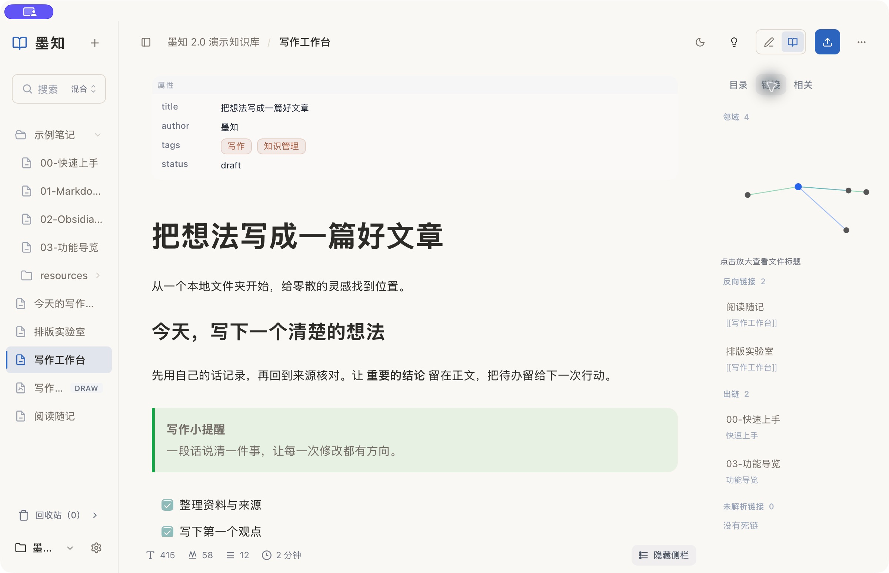
</p>

### 全库搜索与本地索引

在关键词、语义和混合搜索之间切换，点击命中内容回到原文。在 **设置 → 小知助手** 查看状态、重建索引和配置排除路径。本地语义检索需要先下载模型并完成索引，也可使用兼容的语义接口。

<p>
  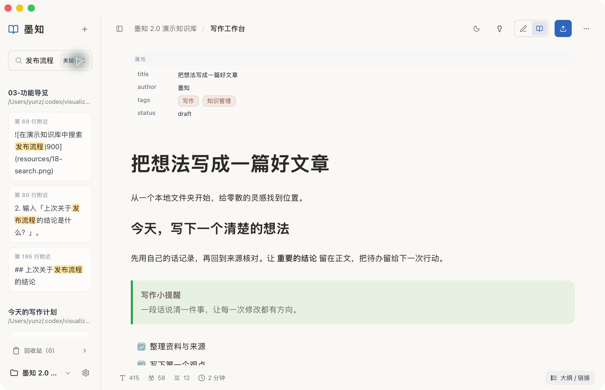
</p>

<p>
  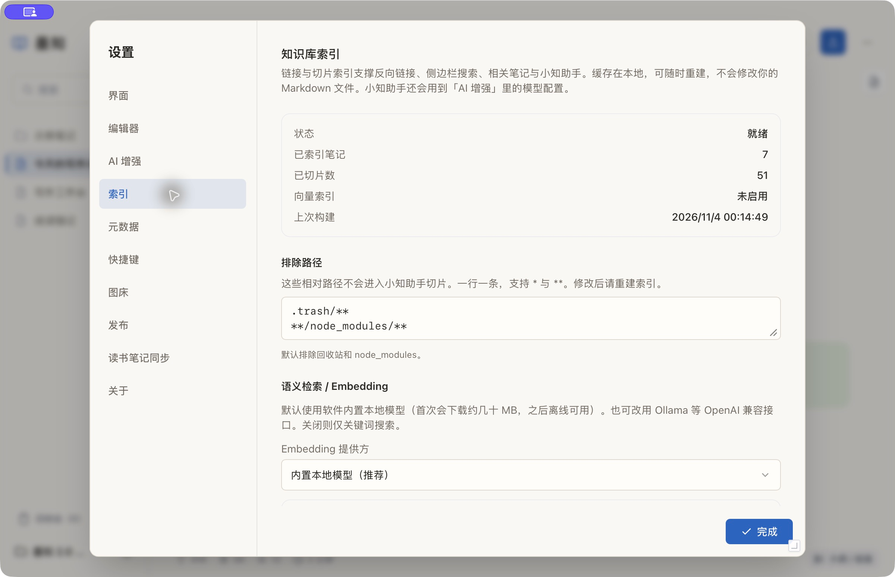
</p>

### 小知助手

先用「仅检索」查看来源片段，再按需生成带引用的回答，点击来源回到笔记。仅检索不要求配置生成模型；关键词检索使用本地文本索引，语义检索需要对应模型和索引，若配置了远端 embedding 接口，仍会把查询发送到该接口。生成回答需先配置 AI 供应商，会把问题和检索片段发送给所选模型。

<p>
  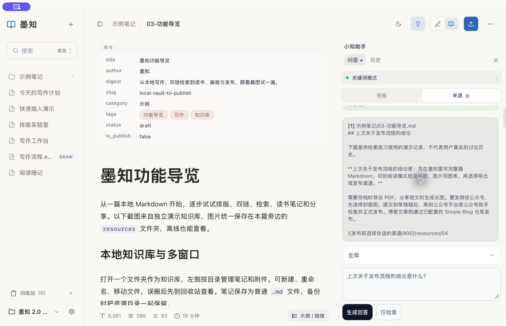
</p>

### AI 增强与 Wiki 生成

支持 Gemini、OpenAI、DeepSeek、GLM、Kimi、Xiaomi MiMo，用于笔记增强、Wiki 生成和问库。顶部小知助手右侧的 **AI 增强** 处理当前笔记，依次显示准备、分析与整理结果的提示，选中文字后可从右键菜单生成 Wiki，设置中可调整 Wiki 保存目录和生成提示词。各供应商独立保存密钥与模型，支持兼容接口的供应商可设置地址，也可使用预设或自定义模型 ID。套餐密钥需填写套餐专用地址，密钥通过本机安全存储保存。

<p>
  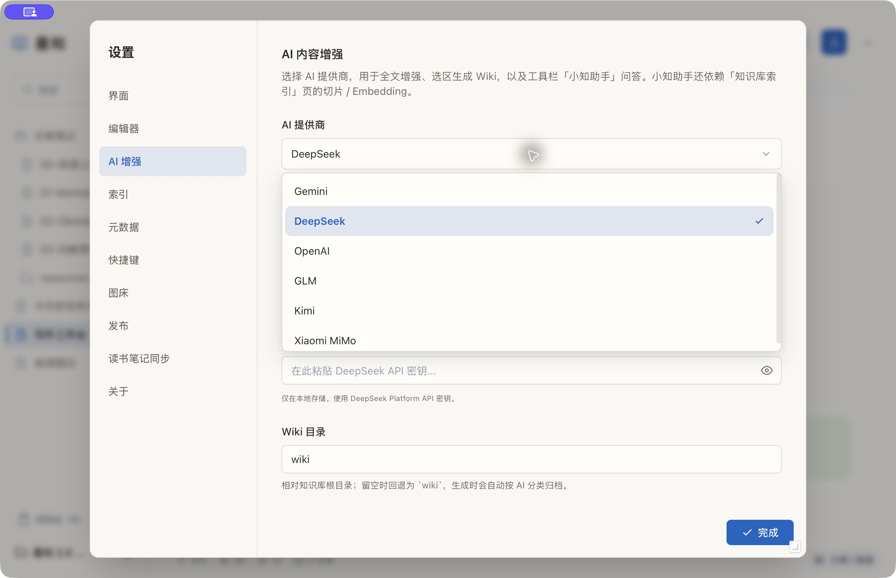
</p>

### Excalidraw 画板

右键点击侧边栏空白处或文件夹，新建画板，使用图形、箭头和文字整理结构。兼容 `.excalidraw` 与 Obsidian `.excalidraw.md`，可通过 `![[drawing.excalidraw]]` 嵌入笔记。

<p>
  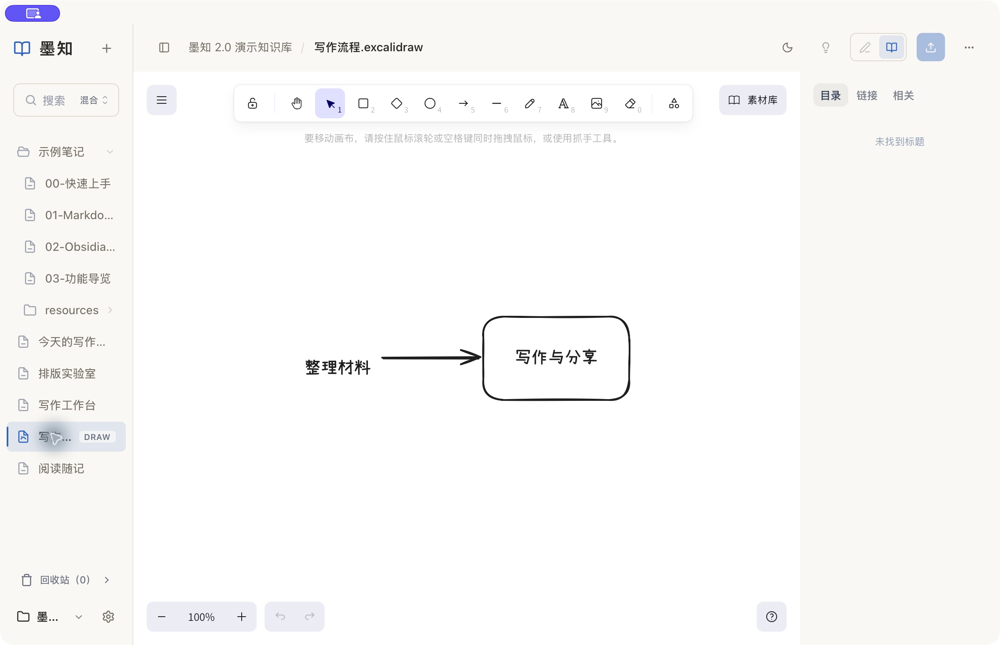
</p>

### 微信读书笔记导入

在 **设置 → 读书笔记同步 → 微信读书** 配置 Skill API Key，选择书籍后导入划线和想法。支持合并、跳过或覆盖，目录结构、本地封面和热门划线统一在设置中配置，并可更新 Skill。书摘关联评论，划线高亮；原始数据缺少上下文时保留已有原文，书签只统计数量。

<p>
  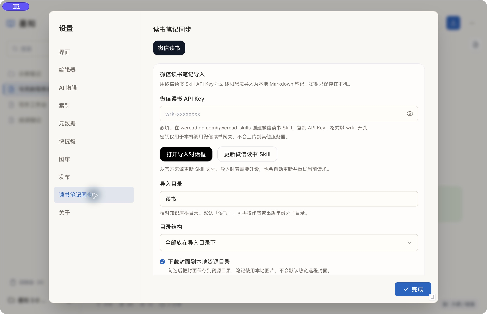
</p>

### PDF、HTML 与长图分享

顶部 **更多** 中的图标分别提供 **导出 PDF**、**导出 HTML** 和 **长图分享**，悬停可查看名称。长图对话框可生成纵向 PNG、预览、保存、复制和系统分享。导出前会读取编辑器的最新输入。

<p>
  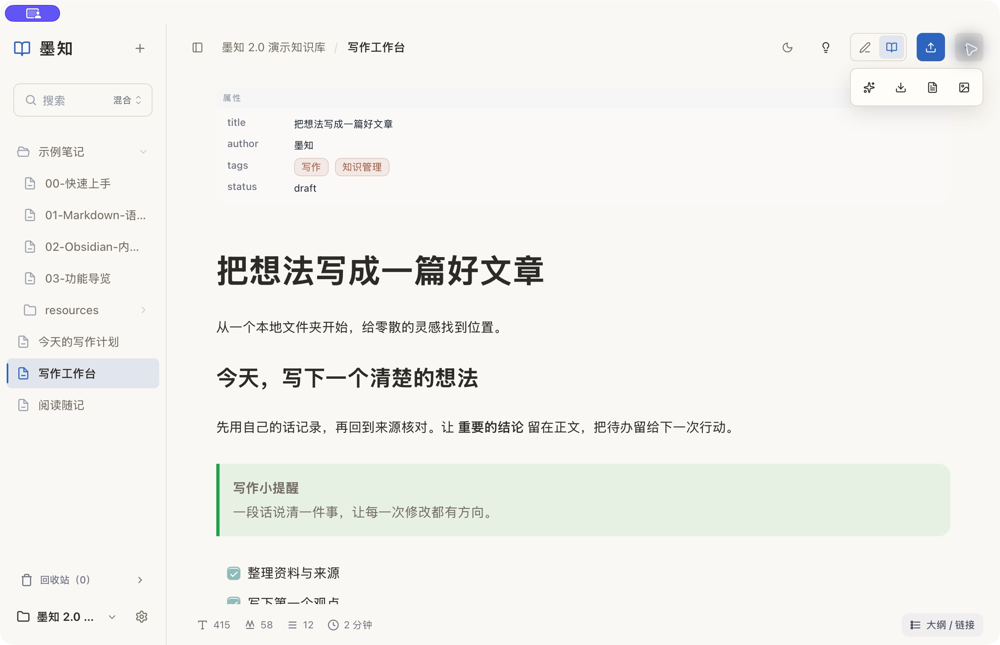
</p>

<p>
  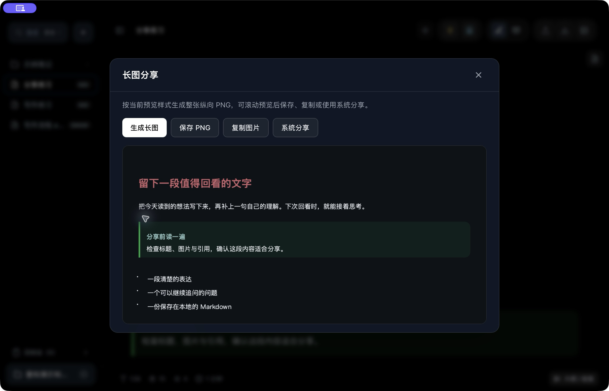
</p>

### 微信公众号草稿

配置公众号后，从 **发布** 选择微信公众号，检查标题、作者、摘要、封面和手机排版预览。未设置封面时默认使用正文首图，也可选择、粘贴或拖入图片更换。提交到草稿箱后仍需在公众号平台完成正式发布。再次提交可更新已有草稿；本次演示只展示预览界面。

<p>
  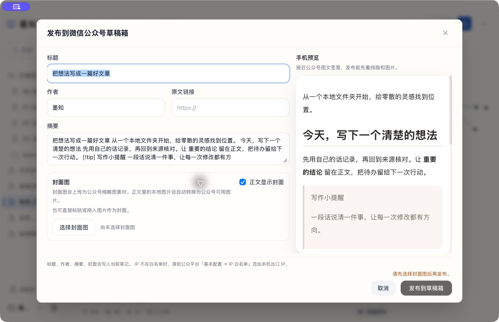
</p>

### Simple Blog 发布

部署配套博客后，在 **设置 → 发布** 填写仓库地址、公开站点和 GitHub 令牌。发布同步文章与图片并写回文章链接，`status` 记录写作状态，`is_publish` 记录博客发布状态。下图展示配置入口。

<p>
  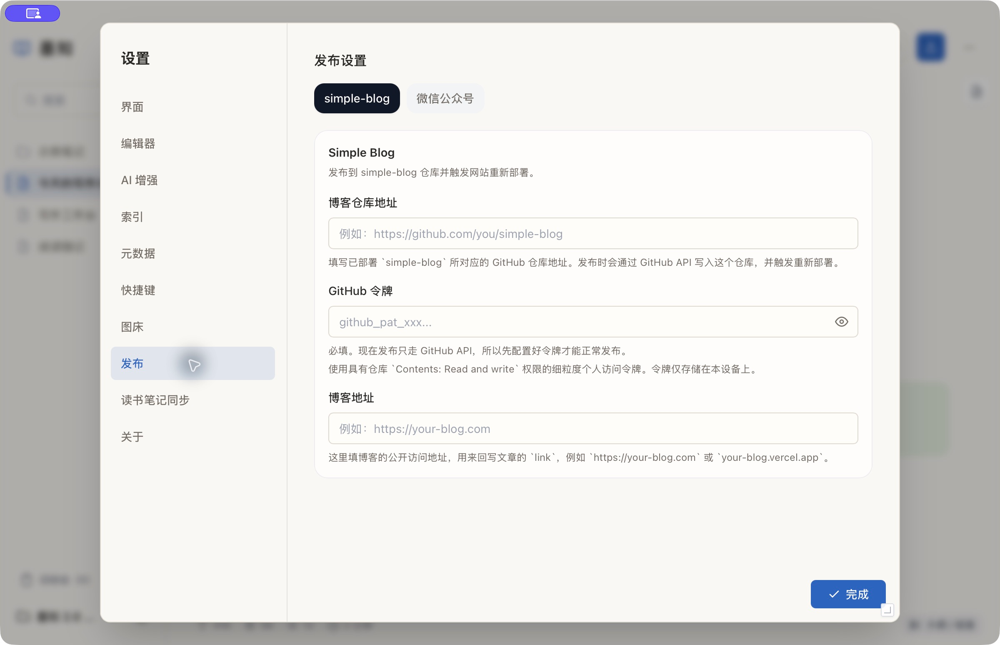
</p>

### 本地图片与可选图床

图片可留在知识库并使用相对路径引用。需要上传时，可配置 GitHub、S3 兼容服务、阿里云 OSS、七牛云或自定义 API。内置示例的图片统一放在 `示例笔记/resources`，离线可查看。

<p>
  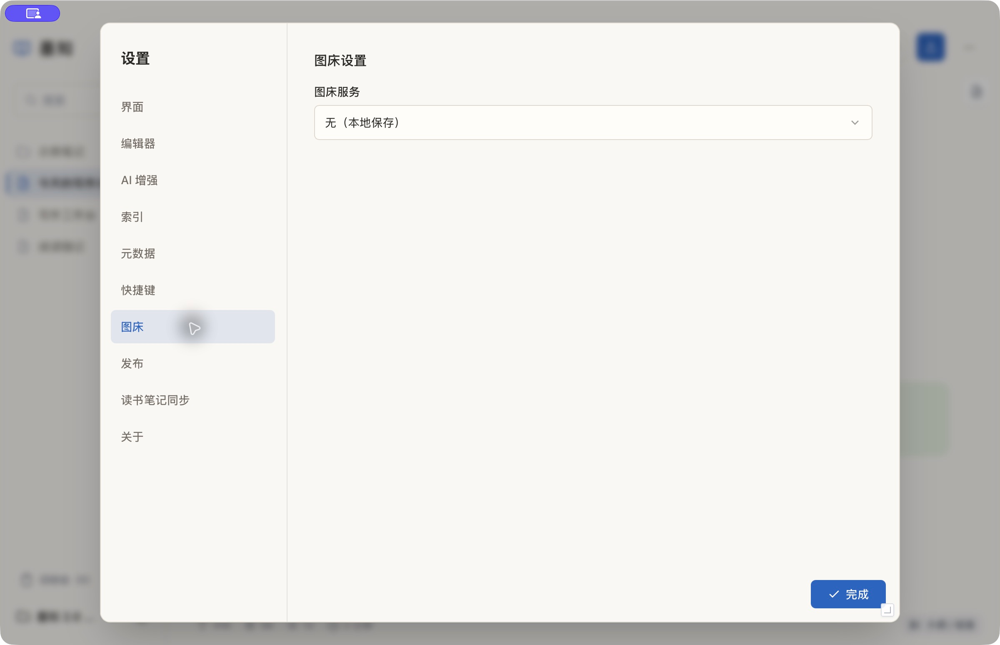
</p>

### 外观、属性与快捷键

在 **设置 → 界面** 选择明暗主题、界面语言和界面字体。主题色支持默认、蓝、绿、紫、玫瑰色，自定义取色器紧接预设排列，选中态、主要按钮和焦点提示随主题色变化。

<p>
  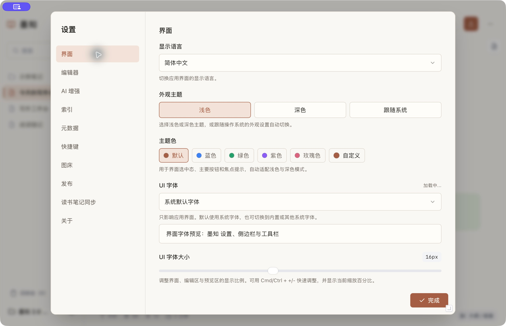
</p>

在 **设置 → 编辑器** 调整正文、阅读与代码字体，控制可读行宽。阅读模式的属性表更紧凑，与正文同宽；关闭「阅读模式显示属性」即可隐藏表格，笔记里的 frontmatter 数据仍会保留。

<p>
  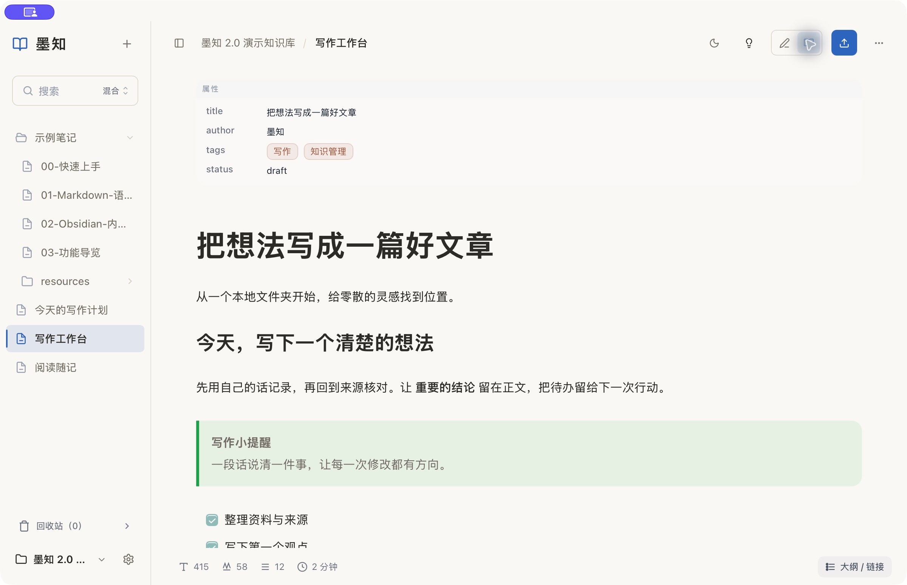
</p>

在 **设置 → 元数据** 配置新笔记的 frontmatter 模板，添加或排序分类、标签、状态、Slug 与别名等字段；在 **设置 → 快捷键** 调整键位。

<p>
  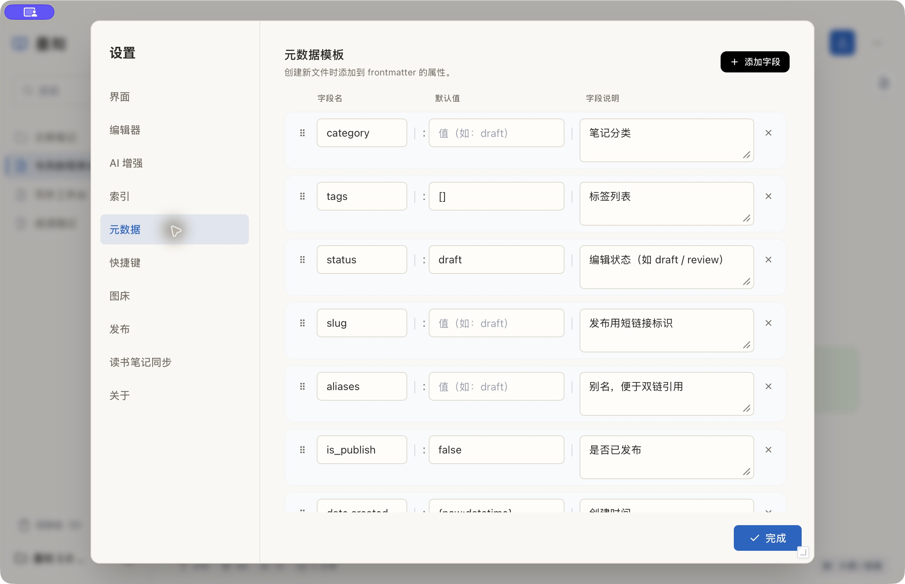
</p>

<p>
  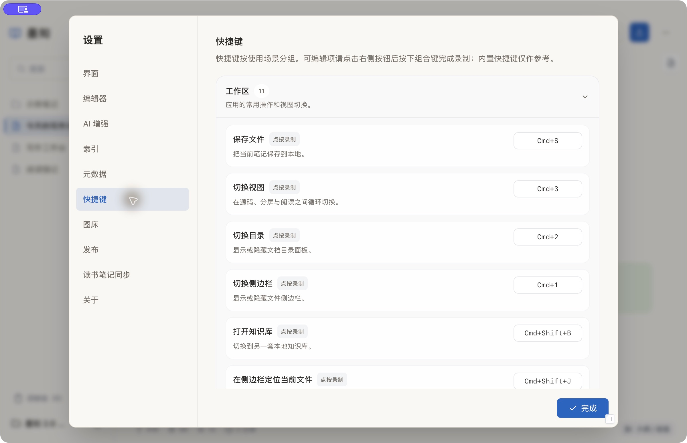
</p>

### 应用更新

在 **设置 → 关于** 查看版本并检查 GitHub Release 更新，按提示下载安装包。

## 常用快捷键

默认键位；完整列表见 **Settings → Shortcuts**。

| 快捷键                                  | 动作                                         |
| --------------------------------------- | -------------------------------------------- |
| `Cmd/Ctrl + S`                          | 保存                                         |
| `Cmd/Ctrl + 0`                          | 设置                                         |
| `Cmd/Ctrl + 1` ~ `5`                    | 侧边栏 / Outline / 视图模式 / 主题 / AI 增强 |
| `Cmd + Shift + F`                       | 当前文件搜索                                 |
| `Cmd + Shift + S`                       | 侧边栏搜索                                   |
| `Cmd + Shift + B` / `J`                 | 打开知识库 / 定位当前文件                    |
| `Cmd + Shift + E`                       | 导出 PDF                                     |
| `Cmd/Ctrl + N` / `Cmd/Ctrl + Shift + N` | 新建笔记 / 文件夹                            |
| `Cmd/Ctrl + Shift + Alt + N`            | 新建窗口（桌面端）                           |
| `Cmd/Ctrl + W`                          | 关闭标签                                     |
| `Cmd/Ctrl + +` / `Cmd/Ctrl + -`         | 放大 / 缩小界面文字                          |
| `Cmd/Ctrl + Shift + 0`                  | 重置界面文字大小                             |
| `Cmd/Ctrl + Shift + -`                  | 清理未引用附件                               |
| `Escape`                                | 关闭搜索面板、弹窗或菜单                     |

## 发布到 simple-blog

在 **Settings → Publishing** 填写：

- **Blog Repository URL**（`https://github.com/owner/repo`、`git@github.com:...` 或 `owner/repo`）
- **博客公开地址**（用于回写 frontmatter 中的 `link`，如 `https://你的域名` 或 `xxx.vercel.app`）
- **GitHub Token**：Fine-grained PAT，对目标仓库开启 **Contents: Read and write**

发布后应用会保存当前笔记、写入 `is_publish: true`，同步 `posts/` 与图片到仓库、改写图片为 raw 链接，并由 GitHub 推送触发 Vercel。

常用 frontmatter：`title`、`aliases`、`slug`、`link`（发布后回填）、`status`（写作状态，不参与是否发布）、`is_publish`。未填 `title` / `aliases` / `slug` 时可用文件名或标题推导；仓库内文件名不因 `slug` 改变。

## 发布到微信公众号草稿

同一设置页配置 **AppID**、**AppSecret**（仅本机安全存储）。工具栏选择微信公众号渠道：填写标题/作者/摘要/原文链接，封面默认使用正文首图，也可手动更换；正文本地图片会上传。首次发布会写入 `wechat_draft_media_id`，再次发布同一篇则更新原草稿。当前为单账号、单图文草稿；若使用服务器域名调用接口，需将出口 IP 加入微信公众平台白名单。

## 许可证

[Apache License 2.0](./LICENSE)

## 致谢

墨知 建立在大量优秀开源项目之上（排名不分先后）。下列为产品运行时直接依赖的主要组件；完整版本与传递依赖见仓库中的 `package.json` / `package-lock.json` 与 `src-tauri/Cargo.toml` / `Cargo.lock`。

### 桌面与界面

| 项目                                                                                    | 用途                           | 许可              |
| --------------------------------------------------------------------------------------- | ------------------------------ | ----------------- |
| [Tauri](https://tauri.app/)（含 API 与 dialog / fs / process / shell / updater 等插件） | 桌面壳、文件系统、对话框、更新 | Apache-2.0 OR MIT |
| [React](https://react.dev/)                                                             | UI                             | MIT               |
| [Zustand](https://github.com/pmndrs/zustand)                                            | 应用状态                       | MIT               |
| [Vite](https://vitejs.dev/)                                                             | 前端构建                       | MIT               |
| [Tailwind CSS](https://tailwindcss.com/)                                                | 样式                           | MIT               |
| [Lucide](https://lucide.dev/)（`lucide-react`）                                         | 图标                           | ISC               |

### 编辑器

| 项目                                                                                   | 用途                            | 许可 |
| -------------------------------------------------------------------------------------- | ------------------------------- | ---- |
| [CodeMirror 6](https://codemirror.net/)（`@codemirror/*`，含 Markdown / 多种代码语言） | Live 编辑、语法高亮、选区与装饰 | MIT  |
| [Lezer Highlight](https://github.com/lezer-parser/highlight)                           | 语法高亮标签                    | MIT  |
| [@replit/codemirror-lang-csharp](https://github.com/replit/codemirror-lang-csharp)     | C# 语言支持                     | MIT  |

### Markdown、预览与画板

| 项目                                                                        | 用途                   | 许可                  |
| --------------------------------------------------------------------------- | ---------------------- | --------------------- |
| [markdown-it](https://github.com/markdown-it/markdown-it)                   | Markdown 解析          | MIT                   |
| [markdown-it-footnote](https://github.com/markdown-it/markdown-it-footnote) | 脚注                   | MIT                   |
| [markdown-it-task-lists](https://github.com/revin/markdown-it-task-lists)   | 任务列表               | ISC                   |
| [GitHub Markdown CSS](https://github.com/sindresorhus/github-markdown-css)  | 预览基础样式           | MIT                   |
| [Shiki](https://shiki.style/)                                               | 代码高亮               | MIT                   |
| [KaTeX](https://katex.org/)                                                 | 数学公式               | MIT                   |
| [Mermaid](https://mermaid.js.org/)                                          | 流程图等图表           | MIT                   |
| [beautiful-mermaid](https://github.com/lukilabs/beautiful-mermaid)          | Mermaid 渲染辅助       | MIT                   |
| [DOMPurify](https://github.com/cure53/DOMPurify)                            | HTML 消毒              | MPL-2.0 OR Apache-2.0 |
| [Excalidraw](https://excalidraw.com/)（`@excalidraw/excalidraw`）           | 手绘白板编辑与嵌入预览 | MIT                   |
| [lz-string](https://github.com/pieroxy/lz-string)                           | Obsidian 图纸压缩格式  | MIT                   |
| [Turndown](https://github.com/mixmark-io/turndown)                          | HTML → Markdown        | MIT                   |
| [js-yaml](https://github.com/nodeca/js-yaml)                                | YAML frontmatter       | MIT                   |

### 导出、PDF 与文档渲染

| 项目                                                        | 用途       | 许可       |
| ----------------------------------------------------------- | ---------- | ---------- |
| [PDF.js](https://mozilla.github.io/pdf.js/)（`pdfjs-dist`） | PDF 预览   | Apache-2.0 |
| [html2canvas](https://html2canvas.hertzen.com/)             | 预览光栅化 | MIT        |
| [html2pdf.js](https://ekoopmans.github.io/html2pdf.js/)     | HTML → PDF | MIT        |
| [jsPDF](https://github.com/parallax/jsPDF)                  | PDF 生成   | MIT        |

### AI 供应商配置

在设置的 AI 页面选择 Gemini、OpenAI、DeepSeek、GLM、Kimi 或 Xiaomi MiMo，可用于内容增强、Wiki 生成和问库。每家供应商独立保存密钥与模型，支持兼容接口的供应商可设置地址，切换供应商不会覆盖其他配置。

GLM、Kimi、Xiaomi MiMo 默认使用官方标准 API；套餐密钥需填写套餐对应的专用地址。模型可使用预设或自定义 ID，Kimi 和 MiMo 也可加载账号可用的模型列表。GLM 使用文档预设，不请求未公开的模型枚举接口。密钥通过应用的安全存储保存，不写入普通设置缓存。

### 知识检索与可选 AI

| 项目 / 服务                                                                                                | 用途                            | 许可 / 说明    |
| ---------------------------------------------------------------------------------------------------------- | ------------------------------- | -------------- |
| [Hugging Face Transformers.js](https://huggingface.co/docs/transformers.js)（`@huggingface/transformers`） | 内置本地 embedding              | Apache-2.0     |
| [Google Gen AI SDK](https://github.com/googleapis/js-genai)（`@google/genai`）                             | 可选 Gemini 调用                | Apache-2.0     |
| [Google Gemini](https://ai.google.dev/) / [OpenAI](https://openai.com/) 兼容接口                           | 可选云端或本地（如 Ollama）模型 | 第三方服务条款 |

Rust 侧还依赖 [serde](https://serde.rs/)、[reqwest](https://github.com/seanmonstar/reqwest)、[uuid](https://github.com/uuid-rs/uuid) 以及加密封装相关 crate（如 `chacha20poly1305`、`hmac`、`sha2` 等），用于配置安全存储与网络请求等桌面能力。

若发现致谢遗漏，欢迎提交 Issue 或 PR 补充。
