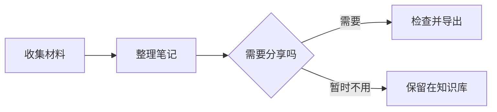
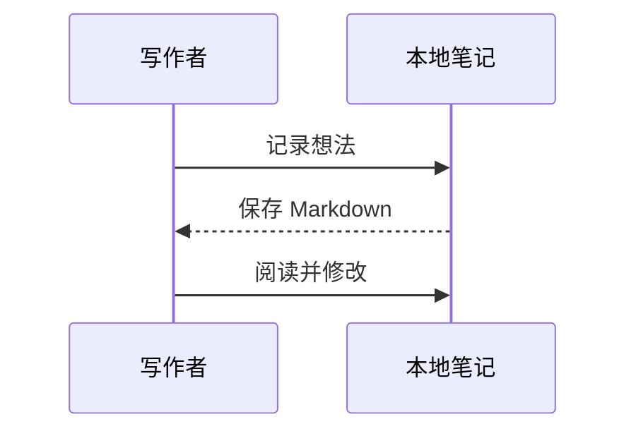
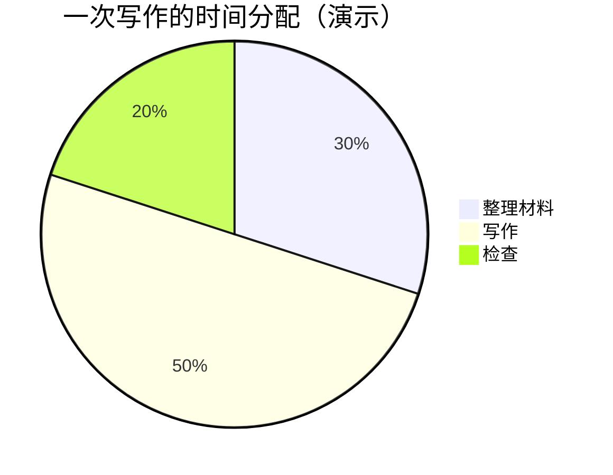

# 用 Markdown 整理一篇笔记

这是一份可以直接修改的排版练习。点击顶部 **实时预览** 编辑，再切到 **阅读** 看完整效果。需要对照写法时，实时预览右上角的 **显示纯文本** 可以显示 Markdown 源码。

返回 [[00-快速上手]]，或继续看 [[02-Obsidian-内联语法示例|双链与附件]]。

## 标题与强调

用 `#` 到 `######` 表示不同层级的标题。正文按内容分段，段落之间空一行。

**粗体**适合结论，*斜体*适合轻微强调，~~删除线~~适合保留已经作废的说法，`行内代码`适合命令和文件名。

```markdown
# 文章标题

## 一个主题

### 更具体的问题

**结论**、_强调_、~~已作废~~、`文件名.md`
```

转义符可以让语法符号显示为普通文字：\*不是斜体\*、\[不是链接\]。

## 列表与任务

把需要逐项完成的动作写成任务列表：

- [x] 收集材料
- [x] 写下结论
- [ ] 补充一张示意图
  - [ ] 检查图中的文字
- [ ] 通读并导出

有先后顺序时用有序列表，子项需要缩进：

1. 写出要解决的问题。
2. 整理能支持判断的材料。
   - 保留来源链接。
   - 把不确定的地方单独记下。
3. 写明下一步。

```markdown
- [ ] 待办事项
- [x] 已完成事项

1. 第一步
2. 第二步
   - 子项
```

## 链接、图片与引用

[返回快速上手](./00-快速上手.md) 是一条相对路径链接。

外部链接也可以直接写成 <https://spec.commonmark.org/>。图片的本地路径与尺寸写法见 [[02-Obsidian-内联语法示例#附件嵌入]]。

> 这是一段演示引用，用来与正文区分。它没有引用任何真实作者的话。
>
> 多段引用之间保留一行 `>`。

```markdown
[显示文字](./00-快速上手.md)


> 这里是引用内容。
```

## 表格

空行输入 `/` 选择表格，或输入 `/3x4`。表格适合对照方案，长段说明留在正文里。

| 分享方式       |  使用场景  | 是否需要在线账号 |
| :------------- | :--------: | ---------------: |
| PDF            | 存档、打印 |               否 |
| 长图           |  分享短文  |               否 |
| 微信公众号草稿 |  图文推送  |               是 |

```markdown
| 左对齐 | 居中 | 右对齐 |
| :----- | :--: | -----: |
| 文字   | 内容 |    100 |
```

## 代码高亮

在三个反引号后填写语言名，例如 `javascript`、`python`、`json`。代码高亮会按语言显示关键字。

```javascript
function buildNote(title, tags = []) {
  return { title, tags, status: "draft" };
}

console.log(buildNote("今天的阅读", ["读书"]));
```

```json
{
  "title": "今天的阅读",
  "status": "draft",
  "is_publish": false
}
```

## 数学公式

行内公式使用单个美元符号，例如 $a^2 + b^2 = c^2$。

独立公式使用两个美元符号：

$$
\sum_{i=1}^{n} i = \frac{n(n+1)}{2}
$$

```latex
$$
\sum_{i=1}^{n} i = \frac{n(n+1)}{2}
$$
```

## Mermaid 图表

将代码块的语言设为 `mermaid`，就可以把流程写成图。



时序图适合说明交互过程：



饼图适合展示一组演示数据，下列数字仅用于说明写法：



`mmd` 也可以作为 Mermaid 代码块的语言标签。

## Callout 提示块

空行输入 `/` 可以插入提示块。也可以直接写 `> [!note] 标题`，下一行继续以 `>` 开头。

> [!note] 留下背景
> 用提示块记录正文之外的补充说明。

> [!tip] 留下可执行的动作
> 写完以后切到阅读模式，检查图片、链接、表格和公式。

> [!warning] 发布前检查
> 示例里的演示数据需要换成自己的内容，再向外发布。

## 脚注

不想打断正文的来源或补充解释，可以放在脚注里。[^fn-demo]

```markdown
正文里的说明。[^fn-demo]

[^fn-demo]: 这是脚注正文，阅读时可以跳转查看。
```

[^fn-demo]: 这是脚注正文，阅读时可以跳转查看。需要长期保留的资料，建议写清标题、作者或原始链接。

---

试着改一处文字、勾选一个任务，再添加一个图表节点。双链、高亮和嵌入继续看 [[02-Obsidian-内联语法示例]]。
