# 墨知功能导览

这份导览对应 **墨知 2.0.0**。从一篇本地 Markdown 开始，逐步试试排版、双链、检索、读书笔记和分享。以下截图来自独立演示知识库，图片统一保存在本篇旁边的 `resources` 文件夹，离线也能查看。

## 认识 2.0.0 工作区

默认采用 macOS 或 Windows 的系统无衬线字体，浅色暖白、深色金属灰。侧栏、正文、上下栏和设置沿用同一套表面与控件样式，左侧栏和设置导航保留淡分隔线。

顶部操作从左到右是主题、小知助手、编辑、阅读、发布、更多，均用图标显示，悬停查看名称。编辑在阅读之前，知识库名称入口仍在左下，设置齿轮在它右侧。AI 增强、PDF、HTML 和长图分享都收在 **更多** 中。

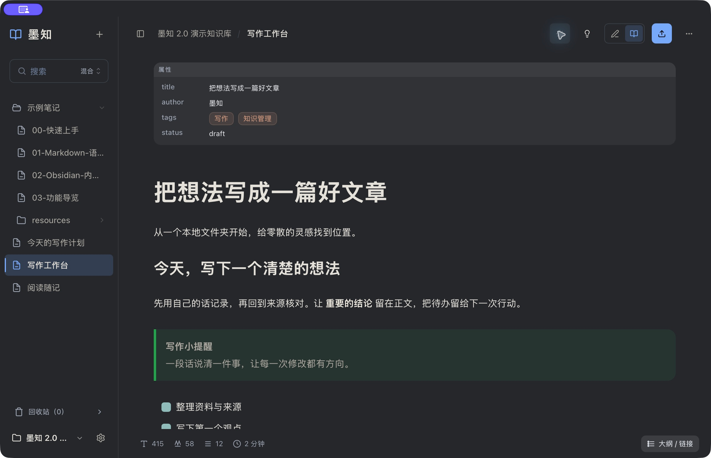

打开知识库和恢复工作区时，也会沿用所选主题与字体。

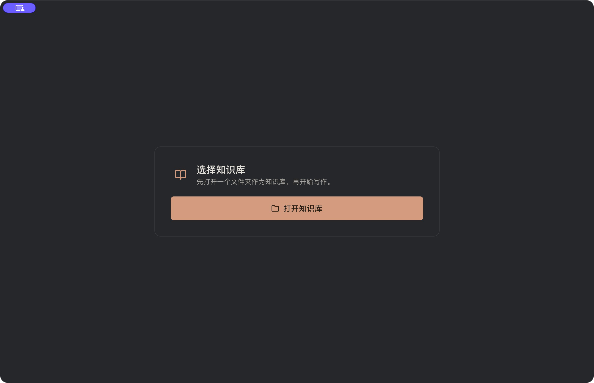

## 本地知识库与多窗口

打开一个文件夹作为知识库，左侧按目录管理笔记和附件。可新建、重命名、移动文件，误删后先到回收站查看。笔记保存为普通 `.md` 文件，备份时把资源目录一起保留。

需要同时查看两份材料时，在命令面板选择「新建窗口」，或按 `Cmd/Ctrl+Shift+Alt+N`。窗口可以分别打开知识库。

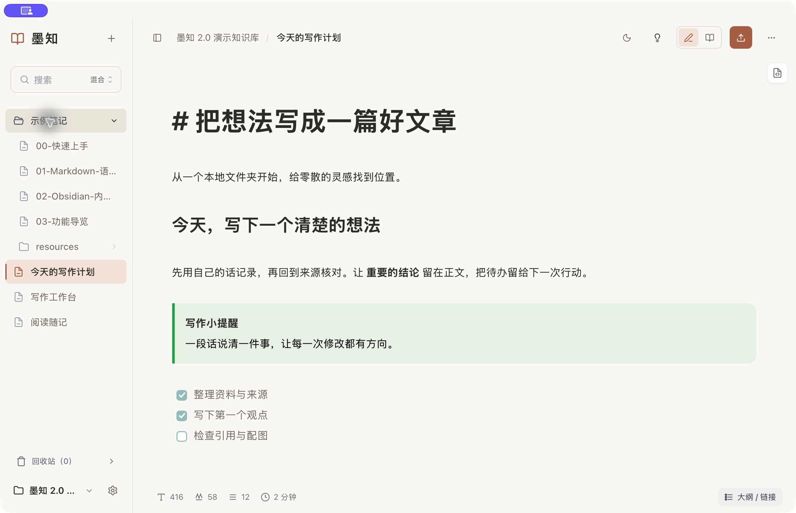

_左侧是演示知识库的真实目录，示例图片集中在 resources 文件夹中。_

## 实时预览与阅读

**实时预览** 中，光标所在处编辑 Markdown，其他位置显示排版。需要检查语法时，使用编辑区右上角的「显示纯文本」；通读成稿时切到 **阅读**。按 `Cmd/Ctrl+3` 可以切换两种视图。

标题、列表、待办、表格、引用、脚注和 Callout 提示块的写法都在 [[01-Markdown-语法示例]] 中，可以直接修改练习。

## 代码、公式与 Mermaid 图表

代码块填写语言名后显示语法高亮；数学公式支持行内与独立公式；`mermaid` 代码块可以绘制流程图、时序图和饼图。阅读时从右侧目录跳到对应小节。

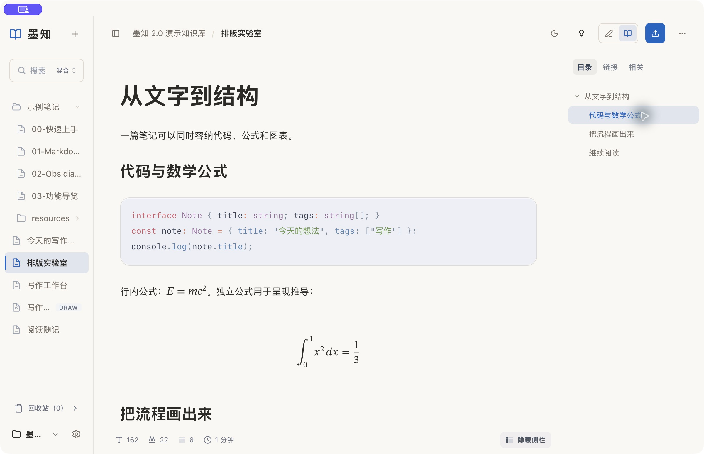

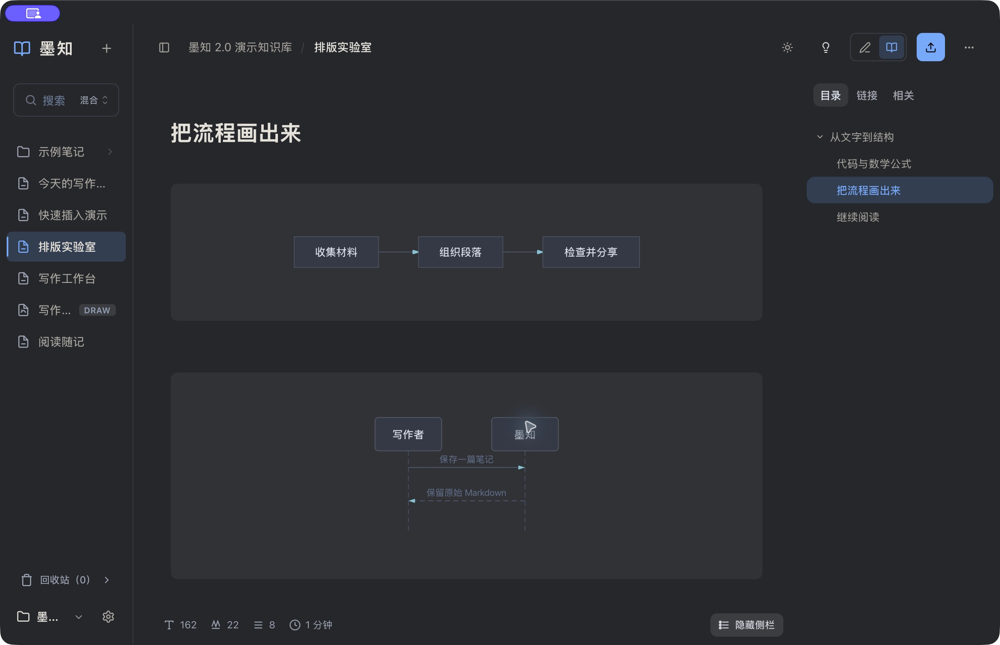

## 斜杠菜单与命令面板

空行输入 `/`，选择表格、待办、代码块、提示块或 Mermaid 图表。输入 `/3x4` 可以快速插入表格。

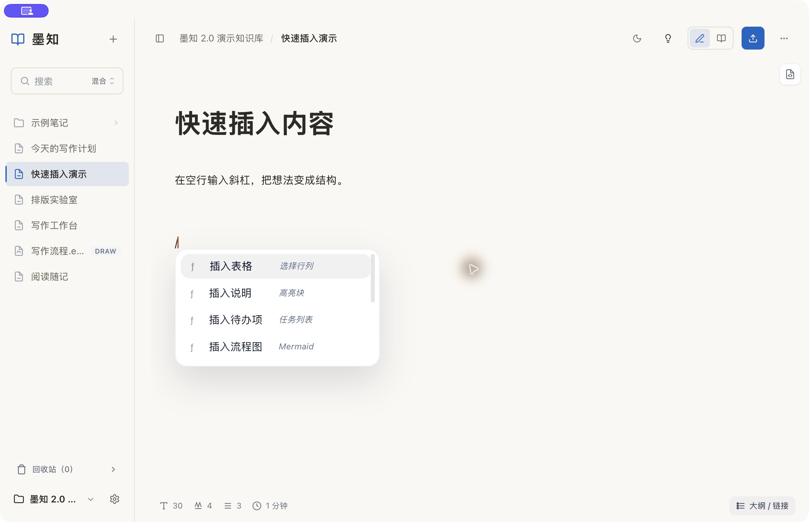

`Cmd/Ctrl+Shift+P` 打开命令面板，按名称查找操作。打开知识库、定位当前文件、新建窗口、插入表格等操作都可以从这里找到。

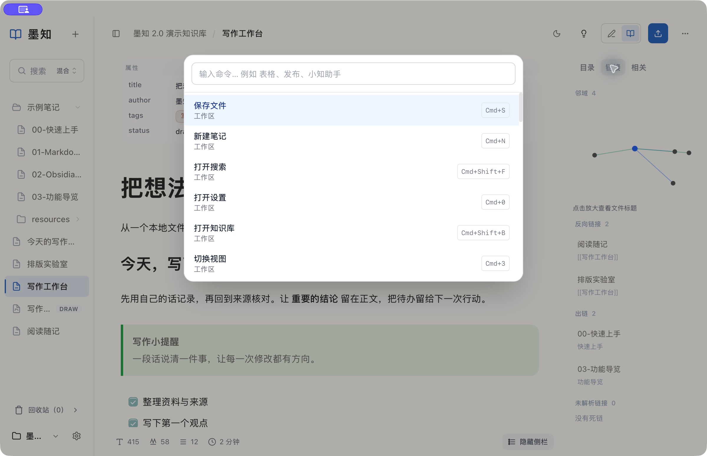

## 双链、嵌入与关系图

输入 `[[笔记名]]` 建立双链，`[[笔记名#标题|显示名称]]` 可以跳到小节并设置别名。用 `![[笔记名#标题]]` 嵌入另一篇笔记的片段，用 `![[resources/图片名.png|720]]` 嵌入本地图片。

右下角的 **大纲 / 链接** 打开侧栏。「目录」查看标题结构，「链接」查看反向链接、出链、未解析链接和邻域关系图，「相关」查看相关笔记。可点击关系图放大查看文件标题。

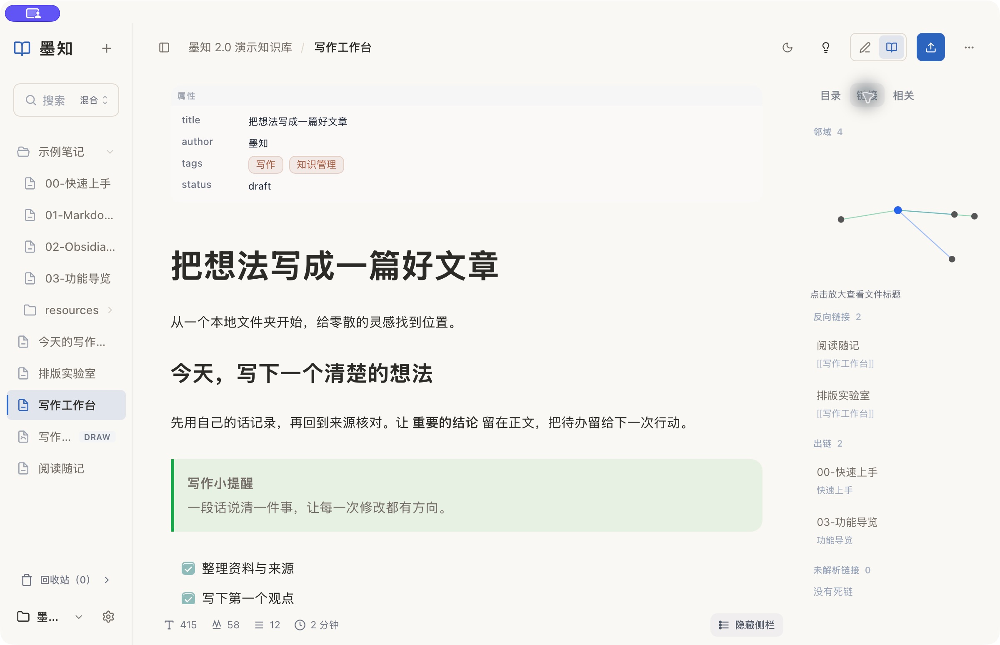

完整写法与可点击的结果见 [[02-Obsidian-内联语法示例]]。

## 搜索与本地索引

左侧搜索可在知识库中找标题和正文，搜索框旁切换关键词、语义或混合模式。命中后打开笔记，回到原文继续阅读。

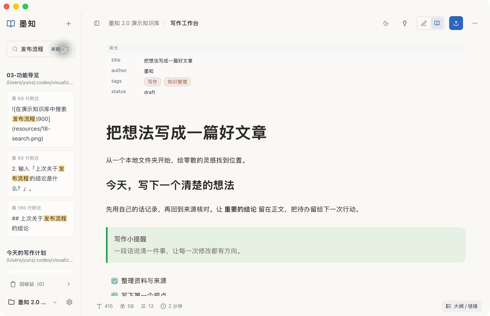

在 **设置 → 索引** 查看索引状态、重建索引或设置排除路径。本地语义检索需要先下载模型并完成索引；也可选择不使用语义模型，或配置兼容接口。刚保存的内容暂时搜不到时，先检查这里。

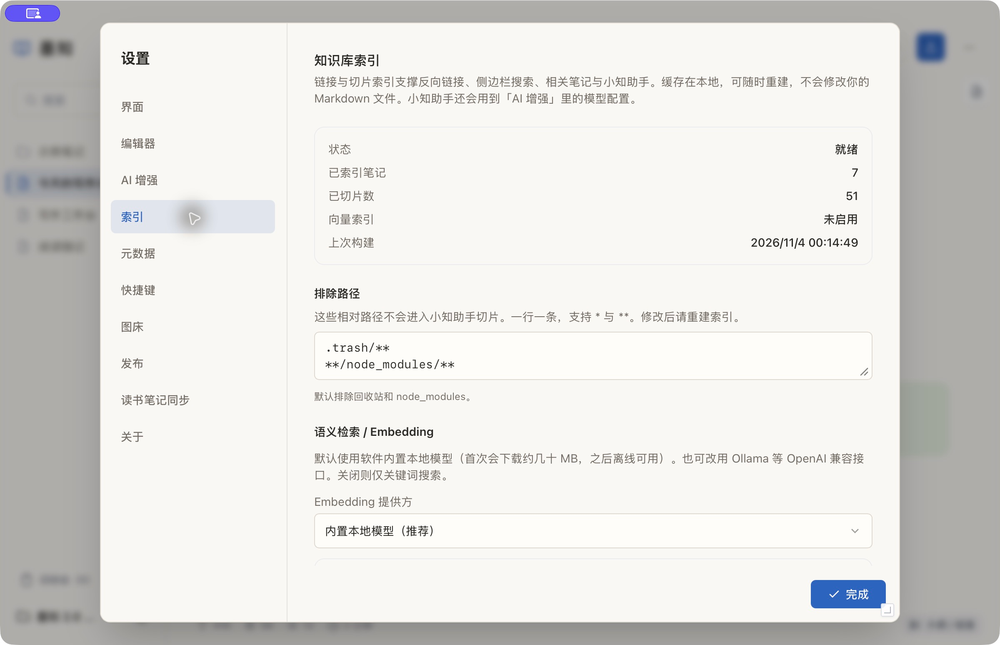

## 先用小知助手找回原文

先在 **设置 → AI 增强** 选择供应商并配置 API Key。当前版本的小知助手需要完成这项配置后才能使用；「仅检索」不会调用生成模型。若语义或混合检索使用远端 embedding 接口，查询仍会发送到该接口；内置本地模型首次使用时需要下载。

1. 点击顶部 **小知助手**。
2. 输入「上次关于发布流程的结论是什么？」。
3. 点击 **仅检索**，查看找到的笔记片段。
4. 点击片段或来源，跳回原笔记核对上下文。

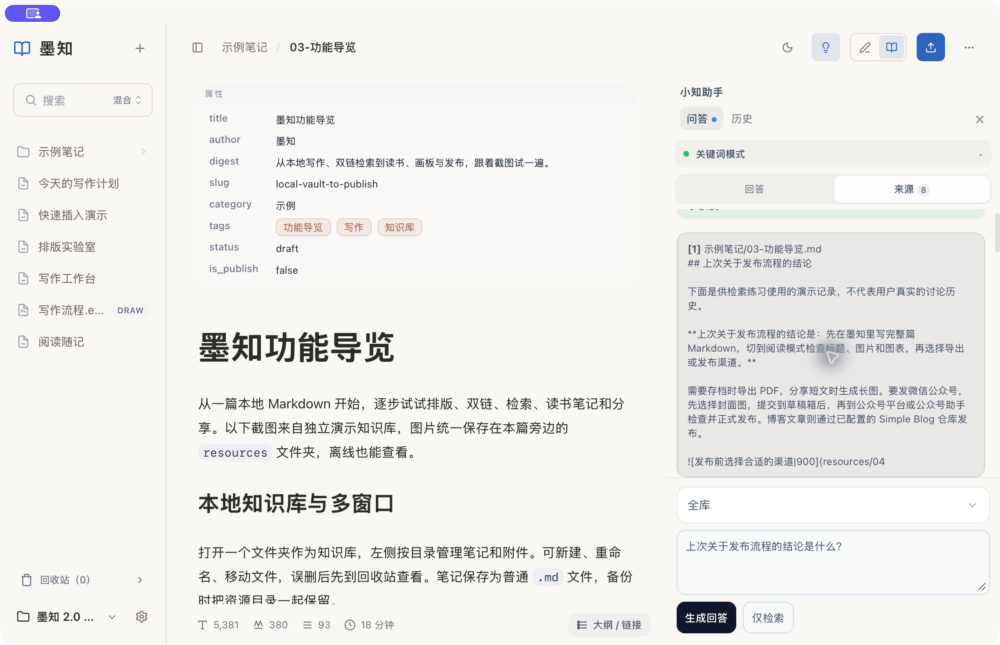

_实拍检索结果：点击来源后，左侧定位到原文；此处没有调用生成模型回答问题。_

需要归纳回答时，使用 **生成回答**。回答中的来源可以点击回到笔记，核对完整上下文。

> [!note] 生成回答会使用哪些内容？
> 小知助手会把检索到的片段作为上下文发送给所选模型。先用「仅检索」看来源，可以知道回答将依据哪些内容。调用在线模型前，请检查这些片段是否适合发送。

## AI 增强与 Wiki 生成

在 **设置 → AI 增强** 选择 Gemini、OpenAI、DeepSeek、GLM、Kimi 或 Xiaomi MiMo，填写自己的密钥和模型。每家供应商独立保存这些配置；支持兼容接口的供应商可设置地址，模型可用性取决于账号权限。套餐密钥需要使用对应的专用接口地址。

顶部 **更多 → AI 增强** 用于处理当前笔记，悬停可查看图标名称；选中文字后可从右键菜单生成 Wiki。设置中可以调整 Wiki 保存目录与中英文生成提示词。生成后先核对内容，再决定保留哪些修改。调用在线模型会发送相应的笔记内容。

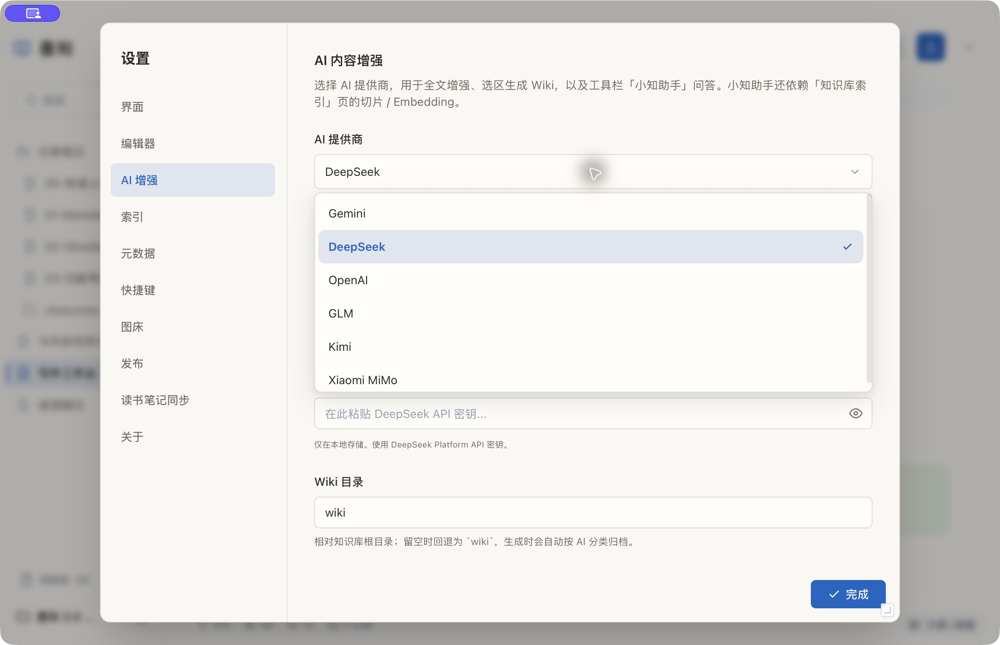

_截图展示供应商选择与配置入口，没有使用有效密钥调用在线模型。_

## Excalidraw 画板

右键点击左侧文件列表的空白处或文件夹，选择 **新建画板**。使用矩形、箭头、文字和自由绘制，把结构先画出来。

支持 `.excalidraw` 和 Obsidian 的 `.excalidraw.md`。在笔记中使用 `![[画板名.excalidraw]]` 嵌入预览，画板文件也要随知识库一起备份。

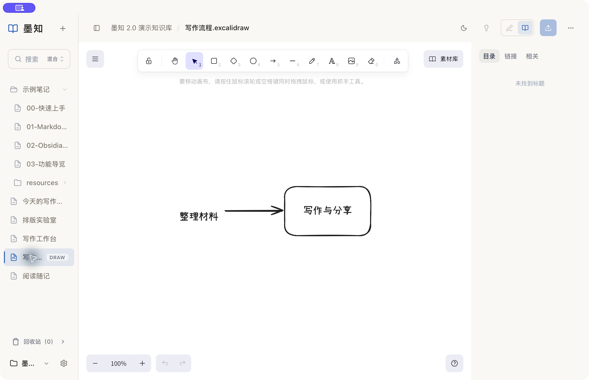

## 把微信读书笔记带进知识库

到 **设置 → 读书笔记同步 → 微信读书** 填写自己的微信读书 Skill API Key，选择导入目录和目录结构，再打开导入对话框选择书籍。「更新微信读书 Skill」可手动更新导入所用的 Skill 文档。

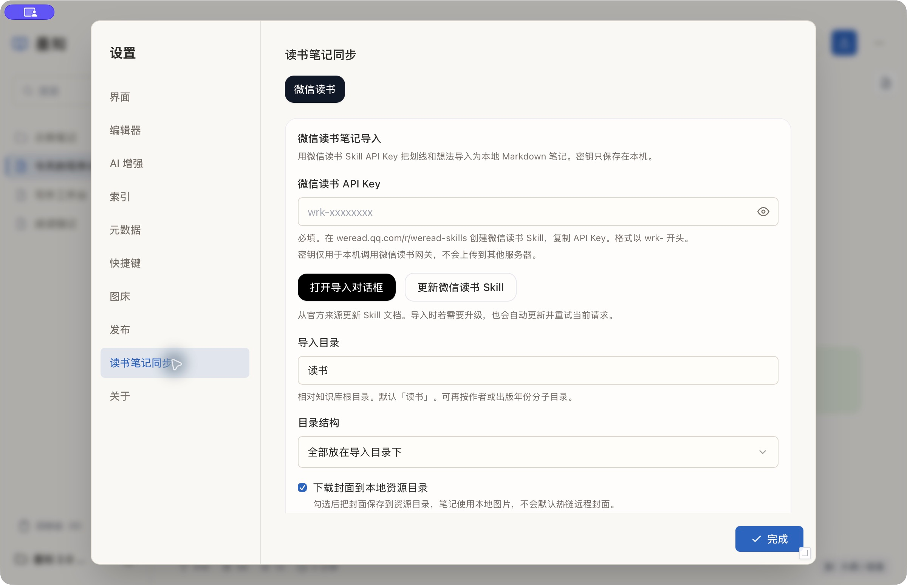

导入会把划线原文与个人想法整理为 Markdown。默认合并同一本书的更新，并保留生成内容之后的个人补充；导入时也可以选择跳过或覆盖。封面下载、热门划线等选项在设置页统一管理。

书摘与对应评论一起阅读，划线部分高亮，书评使用引用样式。原始数据没有完整段落时，保留已有原文；不要把补写内容当成书中原句。书签目前只统计数量，不导出书签正文。

## 选择分享渠道

| 想要的结果           | 入口              | 需要准备                         |
| :------------------- | :---------------- | :------------------------------- |
| 本地存档或打印       | 更多「导出 PDF」  | 通读正文并检查分页               |
| 可在浏览器打开的文件 | 更多「导出 HTML」 | 检查图片和链接                   |
| 适合转发的文章图片   | 更多「长图分享」  | 检查长度与排版                   |
| 微信公众号草稿       | 顶部「发布」      | 公众号配置、标题与封面           |
| 已部署的 Simple Blog | 顶部「发布」      | 博客仓库、站点地址与 GitHub 令牌 |

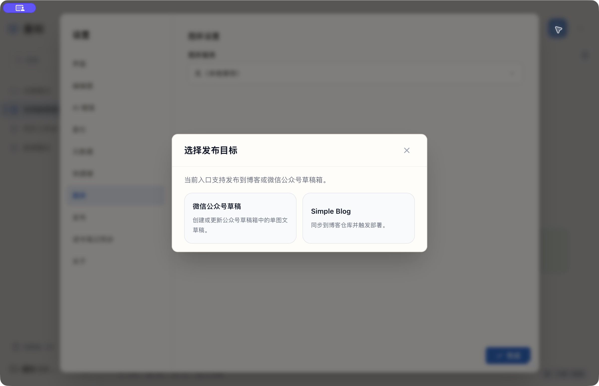

## 导出 PDF 与 HTML

点击顶部 **更多**，悬停找到 **导出 PDF** 或 **导出 HTML** 图标。PDF 用于存档或打印，HTML 可在浏览器打开。导出会先读取编辑器的最新输入；仍建议切到阅读模式，检查图片、表格、代码、公式和图表。

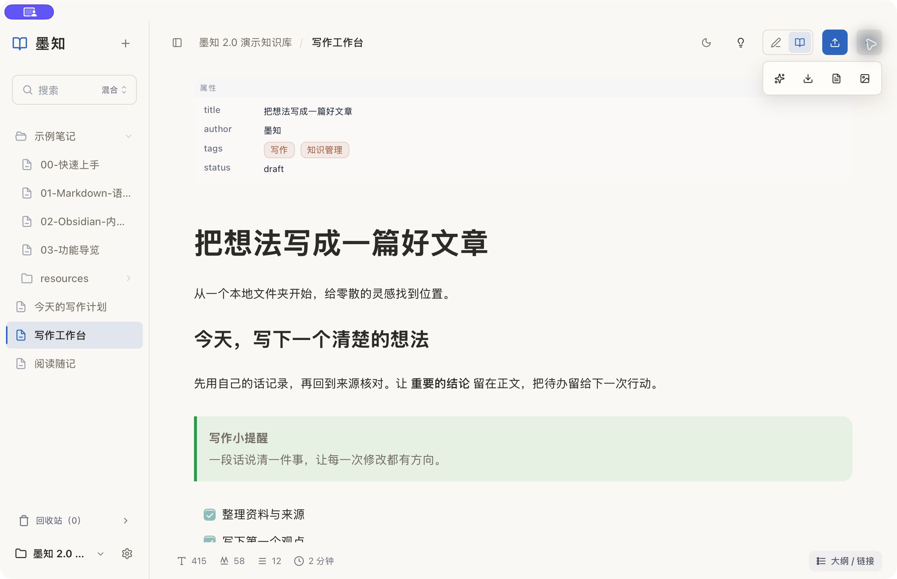

## 长图分享

点击顶部 **更多 → 长图分享** 图标打开对话框，再点击「生成长图」。生成成功后可预览整张纵向图片，再保存 PNG、复制图片或使用系统分享。

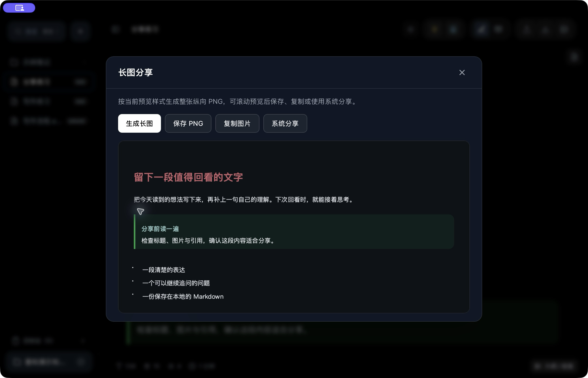

_截图展示生成后的长图，可直接保存或复制。_

## 微信公众号草稿

在 **设置 → 发布** 填写公众号 AppID / AppSecret，并按页面说明配置 IP 白名单。发布时检查标题、作者、摘要和封面图，预览排版后提交。

正文本地图片会在发布时上传。首次成功后，笔记会记录 `wechat_draft_media_id`，再次提交会优先更新已有草稿。**提交草稿不等于正式群发**，最终发布仍在公众号平台完成。

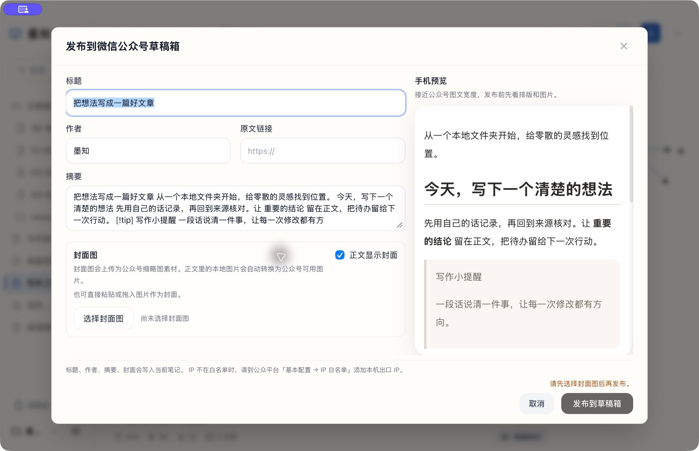

_演示停留在预览步骤，没有向公众号提交草稿。_

## Simple Blog

先部署配套博客，再到 **设置 → 发布** 填写仓库地址、站点地址和 GitHub 令牌。确认标题、Slug 与别名后提交。

发布成功会写回文章链接等信息。`status` 用于记录写作状态，`is_publish` 用于博客发布状态，两者用途不同。

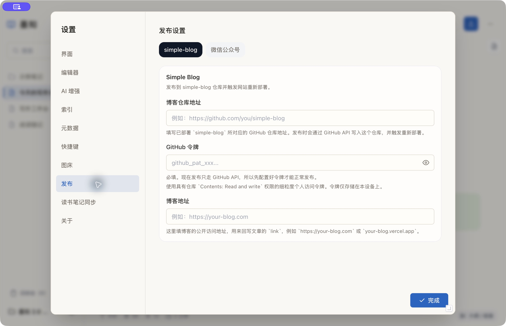

_截图展示配置入口，没有向远端仓库推送内容。_

## 图片与图床

本地图片可以留在知识库中，通过相对路径引用。需要上传图片时，在 **设置 → 图床** 选择 GitHub、S3 兼容服务、阿里云 OSS、七牛云或自定义 API，并填写对应配置。

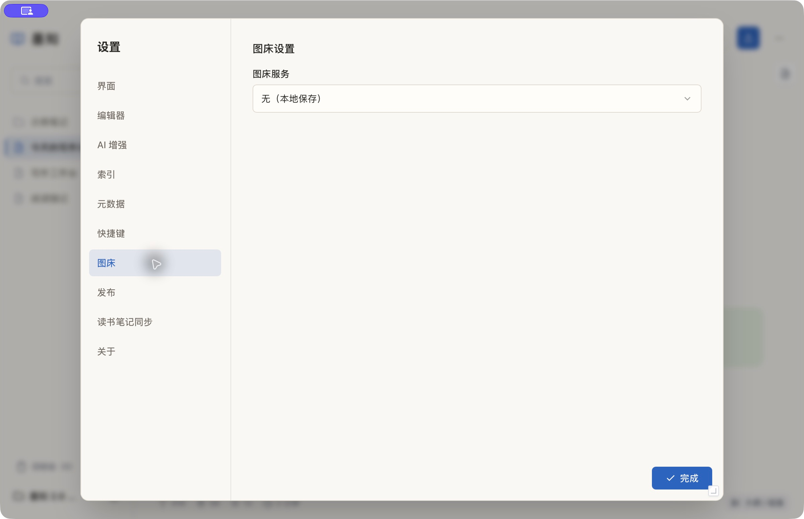

本组示例的图片全部放在 `示例笔记/resources`，不依赖远程图床。

## 外观、属性与快捷键

在 **设置 → 界面** 调整明暗主题、界面语言、界面字体和字号，也可以用顶部月亮或太阳图标切换主题。主题色提供默认、蓝、绿、紫、玫瑰色，自定义取色器紧接预设排列，用于选中态、主要按钮与焦点提示，并适配明暗模式。

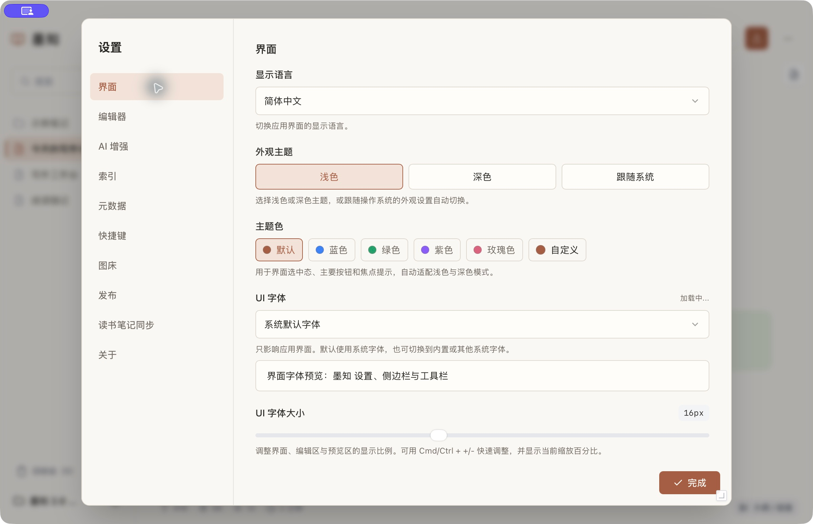

在 **设置 → 编辑器** 调整正文、阅读、代码字体与可读行宽。阅读模式的属性表缩小了字号和行距，与正文同宽；关闭「阅读模式显示属性」只会隐藏表格，不会改动 frontmatter 数据。

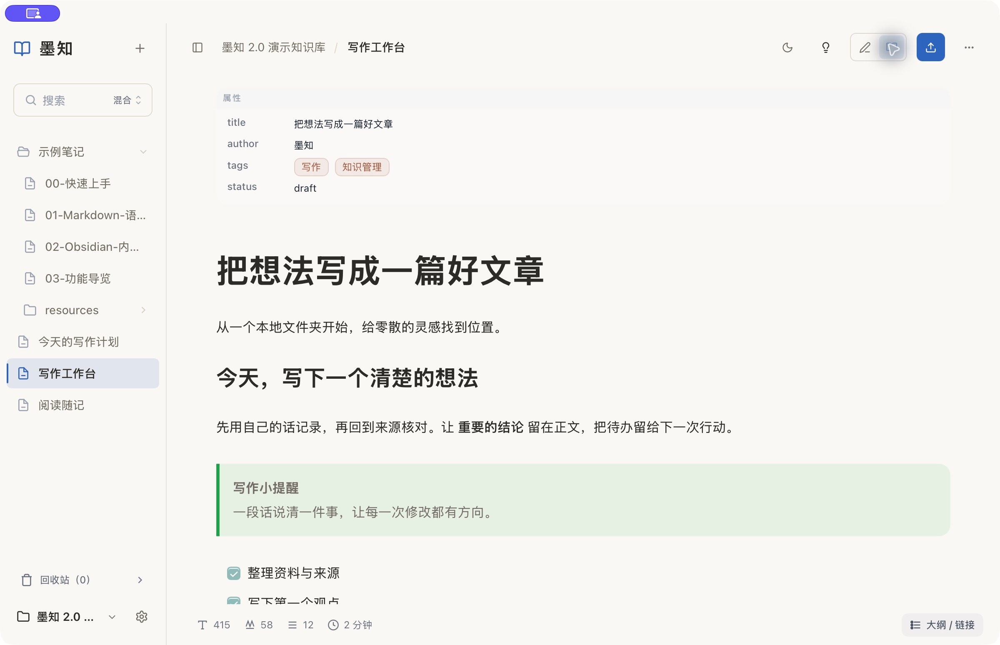

在 **设置 → 元数据** 设置新笔记的 frontmatter 模板，添加或排序分类、标签、状态、Slug、别名和发布状态等字段。

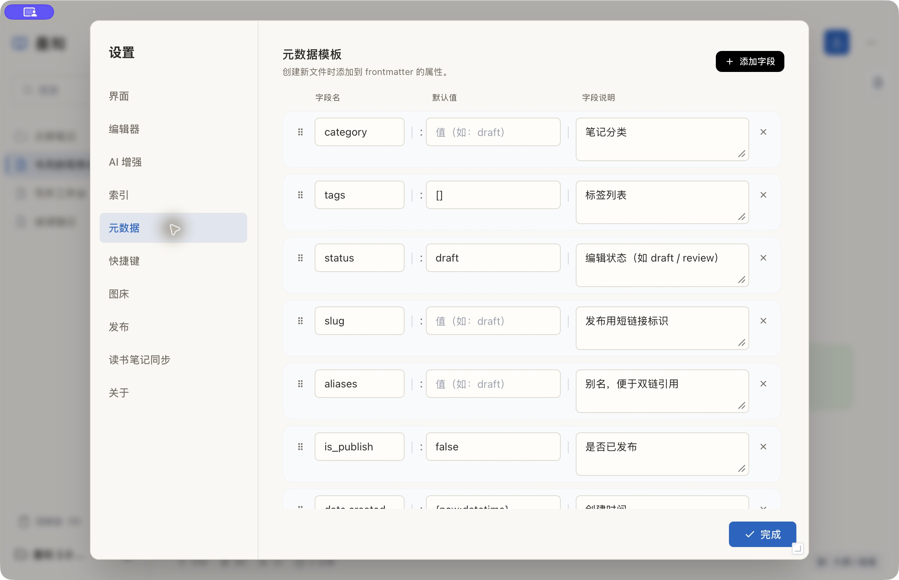

在 **设置 → 快捷键** 查看和修改默认键位。常用操作也可从命令面板找到。

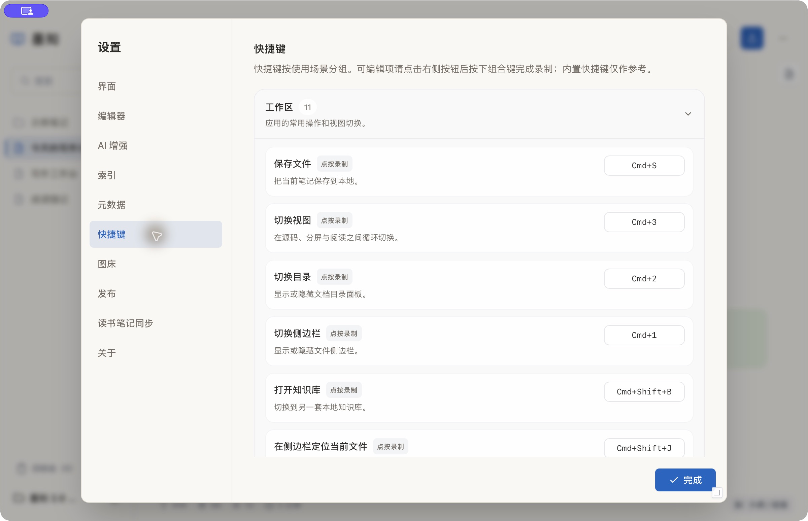

## 检查更新

在 **设置 → 关于** 查看当前版本并检查更新。按页面提示下载安装包，保存当前笔记后再重启软件。

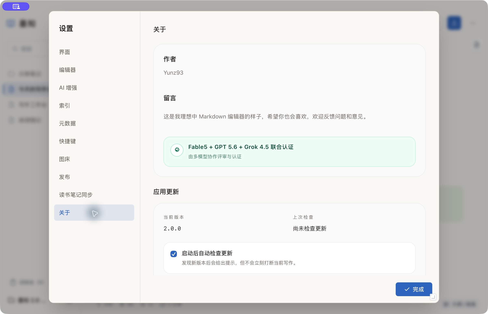

## 上次关于发布流程的结论

下面是供检索练习使用的演示记录，不代表用户真实的讨论历史。

**上次关于发布流程的结论是：先在墨知里写完整篇 Markdown，切到阅读模式检查标题、图片和图表，再选择导出或发布渠道。**

需要存档时导出 PDF，分享短文时生成长图。要发微信公众号，先选择封面图，提交到草稿箱后，再到公众号平台或公众号助手检查并正式发布。博客文章则通过已配置的 Simple Blog 仓库发布。

## 发布前再看一遍

- [ ] 示例标题、作者、摘要和演示数据已替换
- [ ] 阅读模式中的图片、表格、公式和 Mermaid 图表正常
- [ ] 双链和本地附件都能打开
- [ ] 选择了合适的导出格式或发布渠道
- [ ] 公众号封面、博客链接等渠道信息已经确认
- [ ] 生成回答中的引用已回到原文核对

返回 [[00-快速上手]]，或继续修改 [[01-Markdown-语法示例|Markdown 排版练习]]。
